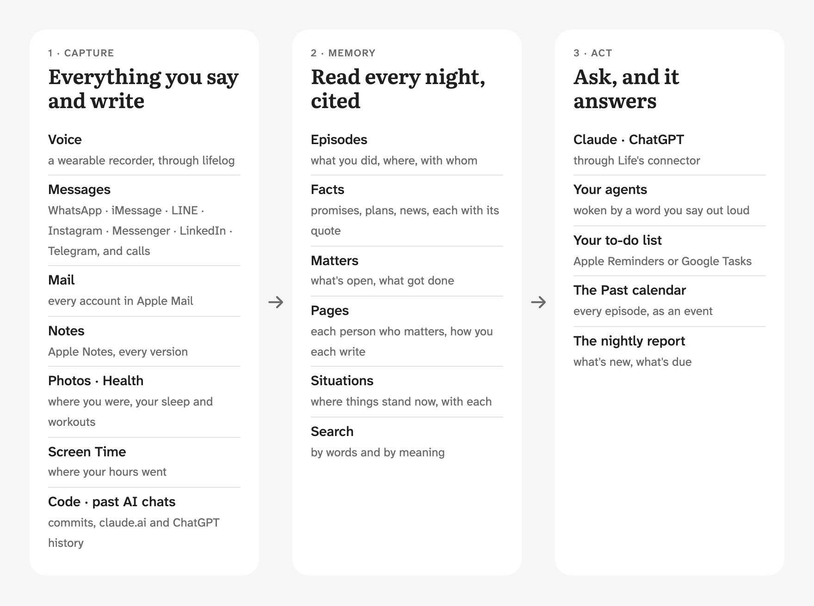
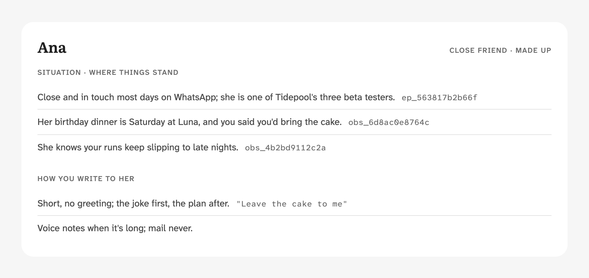
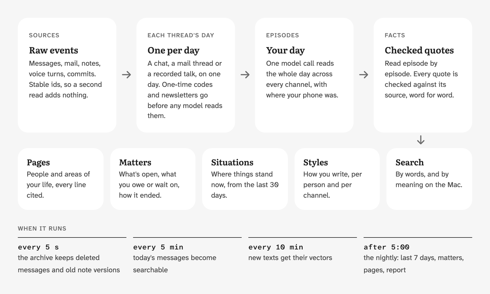

<div align="center">


# Life

A private memory of your life, kept on your own Mac, that Claude or ChatGPT reads to answer you and keep track of
what's open.

<sub>Early: one user so far, installed from source on an Apple-silicon Mac that stays on.</sub>

> **Deprecated:** this README describes Life before the app overhaul ([#1373](https://github.com/eric-edouard/life/issues/1373)) and is no longer kept up to date. Until it is rewritten, see [`docs/product.md`](docs/product.md) and [`docs/handoff/current-state/`](docs/handoff/current-state/).

[](LICENSE)


[What it does](#what-it-does-for-you) · [Add-ons](#optional-about-you-and-the-people-close-to-you) ·
[What it reads](#what-it-reads) · [The pendant](#the-pendant-optional) · [Install](#install) · [Privacy](#privacy)

</div>

Life reads your messages, mail, notes, photos and, if you wear a recorder, your conversations. Every night it works
out what happened, what is still open, who matters to you and where things stand with each of them, then writes it
all down as plain text on your Mac. Your assistant reads that memory through Life's connector and answers from it,
citing each fact.

<picture>
  <source media="(prefers-color-scheme: dark)" srcset="assets/readme/layers-dark.png">
  
</picture>

## What it does for you

> **You:** Has my past week been aligned with my goals? What should I change next week?
>
> *Claude reads Life: `person me`, `search run`, `search friends`, `search Tidepool`*
>
> **Claude:** Mostly yes, as far as Life's records go (15–21 Oct). Tidepool and the flat went well. Running fell
> short, and the records show no time with friends in person.
>
> | Goal | Status | Evidence |
> |---|---|---|
> | Ship Tidepool beta by end of Nov | Ahead | Beta sent to Ana, Leo and Mia on 19 Oct (ep_563817b2b66f) |
> | Run 3×/week | 2 of 3 | Ran 15 and 21 Oct; skipped Sunday after coding until 2am, "*again*" (obs_4b2bd9112c2a) |
> | See friends weekly | No record | Only WhatsApp chats with Ana |
> | Keep the flat in order | Done | Rent sent a day early (obs_58f120ffa801); sink fixed 17 Oct (obs_a5b48d28a3c9) |
>
> Coding late at night is pushing out your runs. Stop by midnight before a run day. Ana's birthday dinner on Saturday
> counts for friends; you said you'd bring the cake (obs_6d8ac0e8764c).

A real run, trimmed, on a made-up person and the demo memory [`scripts/demo.ts`](scripts/demo.ts) writes. Each `obs_…`
(a fact) and `ep_…` (an episode) id opens what it cites and the message it came from. More, with full transcripts:
[examples](docs/examples.md).

Day to day, Life gives your assistant:

- Answers about anything you said, wrote, promised or did, each with its source.
- What's open: the running things in your life (an errand for someone, a repair, a trip being arranged), what you owe,
  what you wait on, what's due. Life also notices when something looks done and your assistant asks you "is this
  done?" in a chat, whenever you like.
- Each person: who they are to you, where things stand now, and how each of you writes to the other, so a draft
  sounds like you.
- A summary of each long conversation your recorder heard, and who was talked about in your chats.
- Your to-do list, in Apple Reminders or Google Tasks, changed only when you ask.

And without being asked:

- Each morning, the night's report: what's new, what's due, what you promised and to whom. It arrives as a
  notification and a page in the app, or [by email](docs/use/settings.md#the-report-by-email).
- The Past calendar: every episode as an event in a calendar of its own, so your week looks back at you where you
  already look ahead. Life can also put the appointments it reads in your messages into your Google calendar, marked
  as Life's. Both are settings ([the agent, the connector and actions](docs/tasks.md)).
- If a source stops reading (WhatsApp signed out, a bridge down), one notice that day saying which.
- Say "hey Life, book the dentist" near your recorder: Life hands it to the agent working on it, else your Personal
  agent. Optional: [your agents](docs/use/agent.md).

<picture>
  <source media="(prefers-color-scheme: dark)" srcset="assets/readme/person-dark.png">
  
</picture>

You correct anything by saying so to your assistant: your word is kept and wins over the memory. Your directory also
holds what Life may keep, in your own words, and that governs what Life writes from then on.

## Optional: about you and the people close to you

Some parts of Life read more personally. Each is off until you switch it on in Life's settings, under **About you and
the people close to you**, and each costs more model calls a night.

| Switch | What it adds |
|---|---|
| **Pages about you** | Your views and your health, on your pages |
| **Between us** | A section on the page of each person close to you: your agreements, your history, the turning points |
| **What people are like** | Each week, what each person is like and what keeps happening between you, your part too |
| **Month by month** | A summary of each past month with each person, from five years back |

## What it reads

Life reads what's already on your Mac, read-only, and only the sources you turn on.

| Source | What Life reads | What you need |
|---|---|---|
| WhatsApp | Every chat, including messages later deleted for everyone, and calls | WhatsApp's Mac app |
| iMessage and SMS | Every chat | Nothing |
| Phone & FaceTime | Your calls: who, when, how long | Nothing |
| Mail | Every account in Apple Mail: mail from people, bookings, bank and deliveries; no newsletters | Apple Mail |
| Apple Notes | Every version of every note, checklists included | Nothing |
| Photos | Where and when you took each photo, and what Apple sees in it | Nothing. A description of each photo, written on your Mac by a local model, is a setting |
| Screen Time | Which apps and websites took your time, on the Mac and the iPhone | Screen Time on |
| Contacts | Names for phone numbers and addresses | Nothing |
| LINE, Instagram, Messenger, LinkedIn, Telegram | Every chat, deleted messages kept, and LINE, Instagram and Messenger calls | Life's own bridges, set up in Terminal, or Beeper Desktop. [Set up bridges](docs/use/bridges.md) |
| Code | Your commits, by repository and day | A folder of repositories, [named in a setting](docs/use/settings.md#your-code) |
| Past assistant chats | Your claude.ai and ChatGPT history | An export, [imported in Terminal](docs/use/settings.md#your-claudeai-and-chatgpt-history) |
| Your voice, places, Apple Health | Your conversations, where you stayed, your sleep and workouts | [The pendant](#the-pendant-optional) |

WhatsApp, the bridged networks, Apple Notes and Screen Time change or forget, so Life keeps its own copy: every 5
seconds an archive saves each new message, each version of a note and each Screen Time record. A message deleted
later, or a note you rewrote, stays readable. That archive lives on your Mac and in your backup, nowhere else.

What each source reads, exactly: [sources](docs/sources.md).

## How it works

<picture>
  <source media="(prefers-color-scheme: dark)" srcset="assets/readme/pipeline-dark.png">
  
</picture>

A model reads your life the way you'd tell it: a day at a time, every channel together, so the voice note, the
WhatsApp thread and the mail about the same dinner end up in one place. It writes down what happened, the facts (each
with its exact quote, checked against its source word for word), and from them a page for each person and each area
of your life, where things stand, and what is still open. Who gets a page is counted from your sources (two-way
chats, time together, how recent), never judged from what a model wrote.

Nothing is ready to ask on day one. After 5:00 tonight Life reads your last 7 days, then every night. Today's
messages are searchable within minutes, as they are; what happened and the facts come with the night. Older months
can be collected for search, without model calls, [from Terminal](docs/use/settings.md#older-months).

How it is built, and why: [architecture](docs/architecture.md). Every word Life uses: [glossary](docs/glossary.md).

## The pendant (optional)

Wear a Limitless Pendant or an Omi and Life also hears your conversations: what was said, who said it and where you
were. lifelog, in this repository, records them through your phone, and its server on your Mac has them transcribed. It adds a
summary of each long conversation, the places you stayed, Apple Health from your iPhone, search by meaning (its
Lifelog Host runs the model Life searches with; without it, search is by words), and "hey" plus your agent's name to
hand it a request out loud.

It is the heaviest part to set up today. You need an iPhone on iOS 27, with lifelog's app built in Xcode under your
own Apple developer team (or an Android phone and the capture app's debug build), Lifelog Host built on a Mac on
macOS 15, and an [ElevenLabs](https://elevenlabs.io) key for transcription, billed by the hour of speech.
[lifelog's README](apps/lifelog/README.md) has the steps; then [set up voice](docs/use/voice.md).

## Install

There is no download yet: today you build Life from source, and a few steps take Terminal. A one-click Mac install,
with every step in the app, is coming ([roadmap](docs/roadmap.md)).

You need a Mac with Apple silicon on macOS 14 or later that stays on and awake at night, [Bun](https://bun.sh) 1.4,
Xcode's command line tools, `rsvg-convert` (`brew install librsvg`) and [Tailscale](https://tailscale.com).

```sh
git clone https://github.com/eric-edouard/life.git
cd life
bun install
bun scripts/app.ts      # builds dist/Life.app, signed ad hoc
open dist/Life.app
```

1. In Life's settings, enter your name, your email and the language Life writes your memory in, and press
   **Start Life**.
2. Under **Thinking**, pick the model Life reads with. You pay its usage, nothing else.
   - An OpenRouter key: paste it, nothing else to install. An allmodels.io key, optional, is its fallback.
   - Your ChatGPT subscription: sign Codex in once, from the checkout:
     `CODEX_HOME="$HOME/Library/Application Support/Life/codex" bunx codex login --device-auth`.
   - Your Claude subscription: [Claude Code](https://claude.com/claude-code) installed and signed in on the Mac.
3. Under **Sources**, turn on the ones you want, press **Open Full Disk Access** and allow Life there.
4. Turn on **Open Life at login**, so it starts with the Mac.
5. [Connect your assistant](docs/use/connect.md) through Tailscale, and pair it with a code from Life's menu.
6. Ask your assistant to read your page and set Life up with you: your goals, the people close to you, your
   projects, and what Life must not keep.

The rest: [settings](docs/use/settings.md).

## Privacy

Your memory is plain text in a git repository on your Mac, with no remote, and Life never pushes it. Your messages,
mail and notes stay in their own apps, opened read-only; the archive of deleted messages stays on your Mac and in your
backup.

What leaves the Mac: the text Life reads, to the model provider you chose (only through hosts that keep no data, for
OpenRouter); what your assistant reads through the connector; and, when you turn them on, the email report, the
encrypted backup, Google for the calendars and Tasks, and ElevenLabs for the pendant's speech. The full list is in
[SECURITY.md](SECURITY.md#what-leaves-the-mac).

Life sends nothing into a chat, ever: its only mail and notifications are to you. The connector reads, and changes
only what you ask in your own words: a correction, something you tell it to remember, an entry in your directory
(your people, projects, goals and what Life may keep), and your to-do list.

## Status and limits

Its author uses Life every day; no one else does yet. It runs on a Mac only.

The app is not signed with a Developer ID or notarized. An ad hoc build loses its Keychain items and its Full Disk
Access each time you rebuild it, unless you set `LIFE_SIGN_IDENTITY` ([apps/mac/README.md](apps/mac/README.md)).

The email report, backups, bridges, the Past calendar and the appointments, Google Tasks, pairing an agent, the code
folder and older months have no screen yet: each takes Terminal ([settings](docs/use/settings.md)).

The models misread: a fact can have the wrong person, the wrong day, or miss that something was done. Every fact cites
its source, so check it before you act on it, and tell your assistant when it's wrong.

An agent you set up runs outside Life's boundary, with whatever access its own app gives it. [SECURITY.md](SECURITY.md)
says what Life protects and how to report a vulnerability.

## Docs

What comes next: the [roadmap](docs/roadmap.md).

Use Life:

- [Examples](docs/examples.md): transcripts and questions to ask
- [Connect your assistant](docs/use/connect.md)
- [Set up voice](docs/use/voice.md)
- [Set up bridges](docs/use/bridges.md)
- [Your agents](docs/use/agent.md)
- [Settings with no screen yet](docs/use/settings.md): email, code, Screen Time devices, older months, add-ons, past
  assistant chats
- [Back up and restore](docs/use/backup.md)
- [Move to a new Mac](docs/use/move.md)

How Life works:

- [Glossary](docs/glossary.md): every name Life uses for a concept, with what it means
- [Architecture](docs/architecture.md): the pipeline, the stack, lifelog and Life, why memory stays local
- [Sources](docs/sources.md): what each source reads and how
- [Schema](docs/SCHEMA.md): every file in the memory
- [The agent, the connector and actions](docs/tasks.md)
- [Operations](docs/operations.md): schedule, services, backups, measuring, the read commands
- [Status reads](docs/status-reads.md): the connector's JSON status reads, for developers

Develop: the commands and rules are in [AGENTS.md](AGENTS.md#commands); also [writing docs](docs/STYLE.md),
[building the app](apps/mac/README.md), [releasing](docs/releasing.md) and the README's pictures
([`scripts/readme-images.ts`](scripts/readme-images.ts)).

## License

[MIT](LICENSE)
