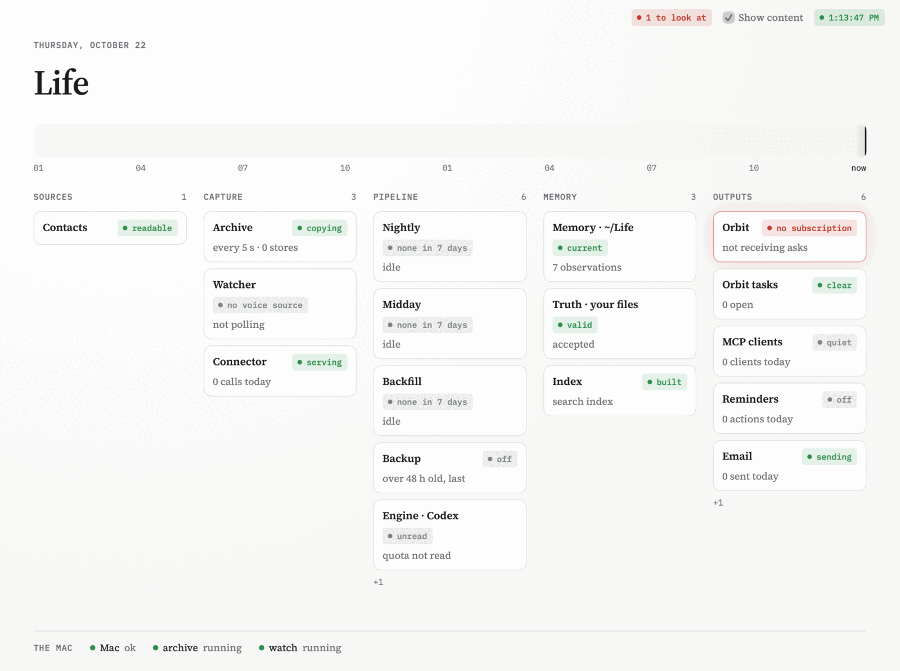

<div align="center">


# Life

Ask Claude or ChatGPT about your own life. Life answers from your messages, mail, notes and, if you want, your voice,
and cites where each answer comes from.

[](LICENSE)


</div>

<picture>
  <source media="(prefers-color-scheme: dark)" srcset="assets/readme/status-dark.png">
  
</picture>

<sub>The status window in Life.app, on made-up demo data before its first night.</sub>

## What it looks like

> **You:** What did I promise my landlord last week? Did I keep it?
>
> *Claude reads Life: `search landlord`, `search rent`, `search apartment`, `day 2026-10-14`, `person jean-dupont`,
> `search plumber`, `day 2026-10-17`*
>
> **Claude:** You made your landlord, Jean Dupont, two promises on Tuesday 13 October over WhatsApp, and you kept both.
>
> **1. Pay the October rent by Friday 16 October:** kept, a day early.
> - The promise: *"I'll send the rent by Friday, sorry for the delay"* (obs_0764db530f56)
> - On 15 October at 18:40 you wrote *"Done, the October rent is sent"* (obs_744a681f06d3, mom_33cb4cebbcea).
>
> **2. Be home Saturday 17 October to let the plumber in for the kitchen sink:** kept.
> - The promise: *"I'll be home Saturday morning to let the plumber in"* (obs_529af414c4f7)
> - Your lifelog shows Hans fixed the sink at the flat at 10:00 that Saturday. He told you *"the drain pipe was cracked,
>   I put in a new one"* (obs_42581ef7537c, mom_3d2da4745984).
>
> **Coming up:** on 21 October, Claire Dupont said she'll send the 2027 lease for you to sign before the end of October
> (obs_0fc1405bd0e4). That's something you're waiting on from her, not a promise you made.

This is a real run, trimmed, on made-up demo data written by [`scripts/demo.ts`](scripts/demo.ts), whose header has
the command to run it again: Claude Code, with Life's read commands as its only tool. Claude.ai and ChatGPT get the
same reads through Life's connector. Each `obs_…` id opens the fact and the message it was quoted from.

## What you need

Required:

- A Mac with Apple silicon on macOS 14 or later, which stays on and awake at night. Life runs there and nowhere else.
- A model to read with: a Claude or ChatGPT subscription (Life uses the `claude` or `codex` command line), or an
  Anthropic or OpenAI API key.
- [Tailscale](https://tailscale.com), signed in on the Mac. It is how Claude and ChatGPT reach Life; without it you can
  only ask from a terminal on the Mac.
- To build the app, as there is no prebuilt release yet: [Bun](https://bun.sh) 1.4, Xcode's command line tools and
  `rsvg-convert` (`brew install librsvg`).

Life reads iMessage, Mail, Apple Notes and your contacts with nothing else installed, once you give it Full Disk
Access. Each of these adds something if you have it:

- WhatsApp's Mac app: your WhatsApp chats, including messages later deleted for everyone.
- Beeper Desktop: LINE, Telegram and Instagram chats.
- lifelog, a companion project that records and transcribes your conversations from your phone: voice, where you were,
  and "hey <agent>" requests. It is not public yet. [Set up voice](docs/use/voice.md).
- [remctl](https://github.com/viticci/remctl): Life changes Apple Reminders when you ask it to. Turn on **Use your
  Reminders** in Life's settings and the app installs it.
- [restic](https://restic.net): a daily encrypted backup, for example into iCloud Drive.
  [Back up and restore](docs/use/backup.md).
- A [Resend](https://resend.com) account: the nightly report by email instead of a notification. Your code's commits,
  older months and your past claude.ai and ChatGPT chats can come in too. These have no screen in the app yet:
  [settings with no screen yet](docs/use/settings.md).

## Install

```sh
git clone https://github.com/eric-edouard/life.git
cd life
bun install
bun scripts/app.ts      # builds dist/Life.app, signed ad hoc
open dist/Life.app
```

Life's settings open on first launch. Enter your name and press **Start Life**. Then pick the model under
**Thinking**, turn on the sources you want, and press **Open Full Disk Access** to allow Life there. Life lives in the
menu bar from then on; turn on **Open Life at login** so it starts with the Mac.

## What happens next

The archive starts at once: every 5 seconds it copies new WhatsApp, Beeper and Notes changes, so a message deleted
later, or an old version of a note, is kept. Nothing is ready to ask yet.

Tonight, on the first check after 2:00, Life reads the last 7 days from every source you turned on. It writes what
happened each day, the facts worth keeping, and a page for each person who matters to you. When it is done you get the
report, by email or as a notification. Tomorrow morning you can ask about last week.

From then on it reads again each night, and at 13:00 and 19:00 it reads the day so far. Older months come in through a
[backfill](docs/use/settings.md#older-months).

The cost is your model usage, nothing else. Each night makes up to one model call per day of the week it reads, then
more for the facts and pages that changed; the status window's engine card shows the tokens used this week. On a
ChatGPT subscription Life reads your Codex quota first and, above 75% used, skips the 13:00 and 19:00 passes and the
backfill. The nightly always runs.

## Connect your assistant

Put Life on your tailnet from its settings, add its address as a custom connector in Claude or ChatGPT, and approve it
with a pairing code from Life's menu: [connect your assistant](docs/use/connect.md).

## Where your data goes

Your memory is plain text in a git repository of its own, on your Mac, with no remote, and Life never pushes it. What
does leave the Mac (the text sent to your model, what your assistant reads, the backup and Life's few sends) is listed
in [SECURITY.md](SECURITY.md#what-leaves-the-mac).

## Status and limitations

Life was built for one person and has one user so far. Its author uses it every day, and it shows: backups, email and
the backfill have no screen in the app yet, only commands.

The app is not signed with a Developer ID or notarized; you build it yourself, and macOS treats it as an app from an
unidentified developer. An ad hoc build also loses its Keychain items and its Full Disk Access every time you rebuild
it, unless you set `LIFE_SIGN_IDENTITY` to an Apple-issued certificate ([apps/mac/README.md](apps/mac/README.md)).

The models misread. A fact can have the wrong person, the wrong day, or miss that something was done. Every fact
cites its source, so check it before you act on it, and tell your assistant when something is wrong: the correction is
kept and wins over the memory.

If you set up an agent (an assistant that acts on "hey <agent>" requests), it runs outside Life's boundary, with
whatever access its own app gives it. [SECURITY.md](SECURITY.md) has the threat model and how to report a
vulnerability.

## Docs

What comes next: the [roadmap](docs/roadmap.md).

Use Life:

- [Connect your assistant](docs/use/connect.md)
- [Set up voice](docs/use/voice.md)
- [Set up your agent](docs/use/agent.md)
- [Settings with no screen yet](docs/use/settings.md): email, code, older months, past assistant chats
- [Back up and restore](docs/use/backup.md)
- [Move to a new Mac](docs/use/move.md)

How Life works:

- [Glossary](docs/glossary.md): every word Life uses, one meaning each
- [Architecture](docs/architecture.md): the pipeline, lifelog and Life, why memory stays local
- [Sources](docs/sources.md): what each source reads and how
- [Schema](docs/SCHEMA.md): every file in the memory
- [The agent, the connector and actions](docs/tasks.md)
- [Operations](docs/operations.md): schedule, services, backups, measuring, the read commands
- [Status reads](docs/status-reads.md): the connector's JSON status reads, for developers

Develop: the commands and rules are in [AGENTS.md](AGENTS.md#commands); also [writing docs](docs/STYLE.md),
[building the app](apps/mac/README.md) and [releasing](docs/releasing.md).

## License

[MIT](LICENSE)
