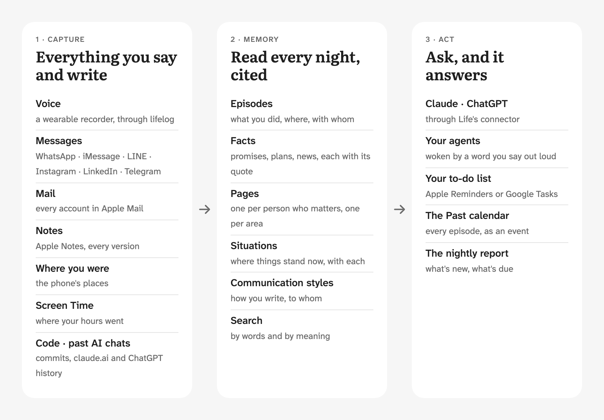
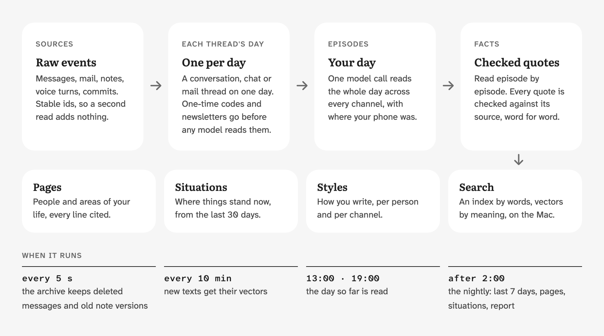
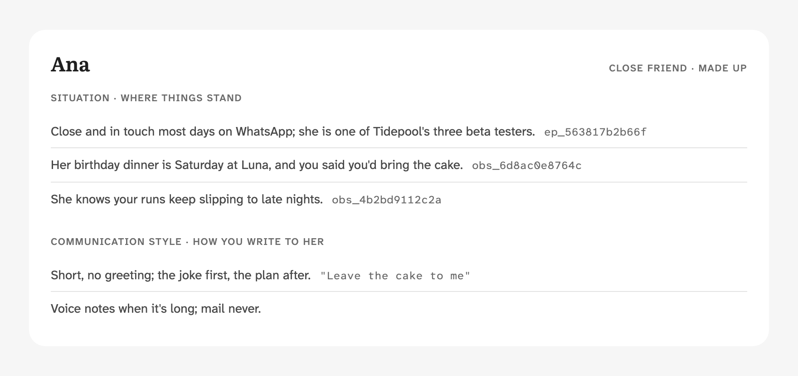
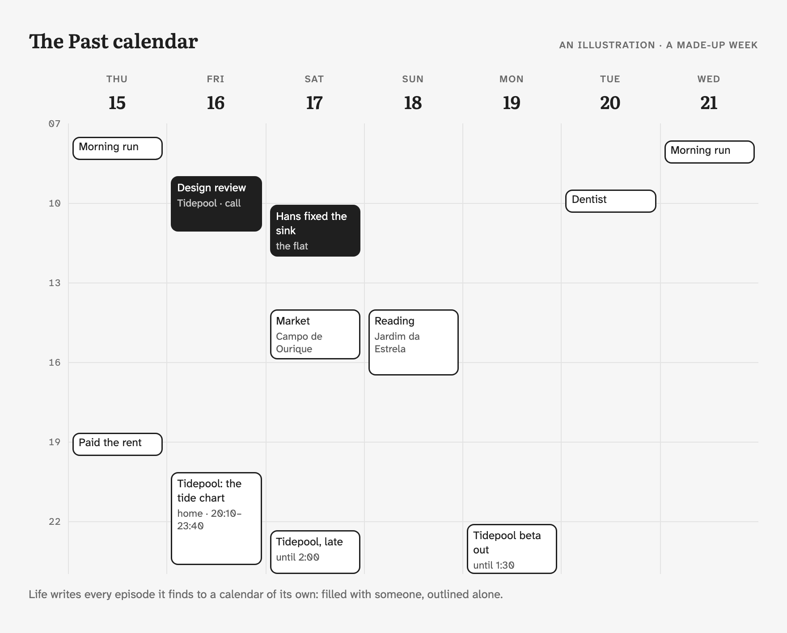
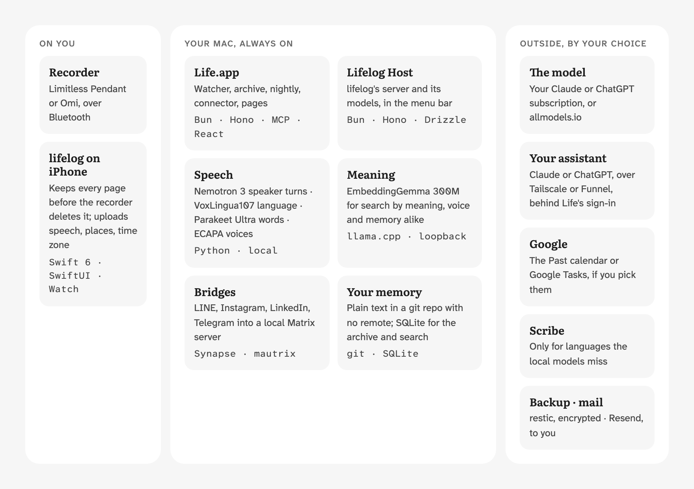

<div align="center">


# Life

A memory of your whole life, kept on your own Mac. Ask Claude or ChatGPT about anything you said, wrote, promised or
did, and get an answer that cites where it comes from.

<sub>Early: one user so far, run from source on an Apple-silicon Mac that stays on.</sub>

[](LICENSE)


[Examples](#ask-it-anything) · [Capture](#1-capture) · [Memory](#2-memory) · [Act](#3-act) ·
[Under the hood](#under-the-hood) · [Install](#install)

</div>

Life reads your messages, mail, notes and, if you wear a recorder, your conversations. Every night it works out what
happened, who matters to you and where things stand with each of them, then writes it all down as plain text on your
Mac. Your assistant reads that memory through Life's connector and answers from it, citing each fact.

<picture>
  <source media="(prefers-color-scheme: dark)" srcset="assets/readme/layers-dark.png">
  
</picture>

## Ask it anything

> **You:** Has my past week been aligned with my goals? What should I change next week?
>
> *Claude reads Life: `person me`, `search run`, `search friends`, `search Tidepool`*
>
> **Claude:** Mostly yes, as far as Life's records go (15–21 Oct). Tidepool and the flat went well. Running fell
> short, and the records show no time with friends in person.
>
> | Goal | Status | Evidence |
> |---|---|---|
> | Ship Tidepool beta by end of Nov | Ahead | Beta sent to Ana, Leo and Mia on 19 Oct (ep_563817b2b66f) |
> | Run 3×/week | 2 of 3 | Ran 15 and 21 Oct; skipped Sunday after coding until 2am, "*again*" (obs_4b2bd9112c2a) |
> | See friends weekly | No record | Only WhatsApp chats with Ana |
> | Keep the flat in order | Done | Rent sent a day early (obs_58f120ffa801); sink fixed 17 Oct (obs_a5b48d28a3c9) |
>
> **The main pattern:** coding late at night is pushing out your runs. The Tidepool progress is real, but a 2am night
> is what cost you a run.
>
> **For next week:** stop coding by midnight, especially before a run day. Ana's birthday dinner on Saturday counts
> for friends; you said you'd bring the cake (obs_6d8ac0e8764c).

A real run, trimmed, on a made-up person: Claude Code with Life's read commands as its only tool, on the demo memory
[`scripts/demo.ts`](scripts/demo.ts) writes; Claude.ai and ChatGPT get the same reads through Life's connector. The
goals are the ones that person wrote in `truth/me.md`. In your assistant, each `obs_…` (a fact) and `ep_…` (an episode)
id opens what it cites and the message it came from.

Also: "What did I promise my landlord last week?", "How are things with Ana right now?", "What did the message Leo
deleted on WhatsApp say?" More, with full transcripts: [examples](docs/examples.md).

## It also works when you don't ask

- Each morning you get the night's report: what's new, what's due, what you promised and to whom.
- When Life isn't sure about a fact, it asks you on its decisions page, one question at a time, whenever you like.
- Say "hey Orbit, book the dentist" near your recorder, Orbit being an agent of yours: Life hears it, and Orbit
  picks it up and gets on with it. [Set up your agent](docs/use/agent.md).
- If a source stops reading (WhatsApp signed out, a bridge down), you get one email that day saying which.

## 1. Capture

Life reads what's already on your Mac, read-only, plus a few things it keeps on purpose.

| Source | What Life reads | What you need |
|---|---|---|
| Your voice | Every conversation a wearable recorder hears, transcribed, with who spoke and where you were | [lifelog](apps/lifelog/README.md), in this repo: a Limitless Pendant or an Omi, and an iPhone. [Set up voice](docs/use/voice.md) |
| WhatsApp | Every chat, including messages later deleted for everyone, and calls | WhatsApp's Mac app |
| iMessage and SMS | Every chat, named from your contacts | Nothing |
| LINE, Instagram, LinkedIn, Telegram | Every chat, deleted messages kept, and LINE and Instagram calls | Life's own bridges or Beeper Desktop. [Set up bridges](docs/use/bridges.md) |
| Mail | Every account in Apple Mail: mail from people, bookings, bank and deliveries; no newsletters | Apple Mail |
| Apple Notes | Every version of every note, checklists included | Nothing |
| Contacts | Names for phone numbers and addresses | Nothing |
| Screen Time | Which apps and websites took your time, on the Mac and the iPhone | Screen Time on |
| Code | Your commits, by repository and day | Your repositories in one folder. [Settings](docs/use/settings.md) |
| Past assistant chats | Your claude.ai and ChatGPT history | An export file. [Settings](docs/use/settings.md) |

WhatsApp, the bridged networks, Apple Notes and Screen Time change or forget, so Life keeps its own copy: every 5
seconds an archive saves each new message, each version of a note and each Screen Time record. A message deleted later, or a note you rewrote, stays readable. That
archive lives in your Mac's Application Support folder and in your backup, nowhere else.

What each source reads, exactly: [sources](docs/sources.md).

## 2. Memory

<picture>
  <source media="(prefers-color-scheme: dark)" srcset="assets/readme/pipeline-dark.png">
  
</picture>

A model reads your life the way you'd tell it: a day at a time, every channel together. The voice note, the WhatsApp
thread and the mail about the same dinner end up in one place. It writes down:

- Episodes: what you did, when, where and with whom, and what came of it. They also go to your Past calendar.
- Facts: promises, plans, news, things someone told you, each with its exact quote. Life checks every quote against
  its source, word for word, so a fact can't cite something nobody said.
- Pages: one for each person who matters to you and each area of your life (a project, your health), every line
  citing its facts. Close people get a
  section that doesn't age: your agreements, your history, the turning points.
- Situations: where things stand now, for you and for each person close to you, rebuilt each night from the last 30
  days. This is what answers "how are things with Ana?".
- Communication styles: how you write, to each person and on each channel, with examples in your own words, so an
  agent drafting a message for you sounds like you.
- Search, by words and by meaning, across languages, computed on your Mac.

<picture>
  <source media="(prefers-color-scheme: dark)" srcset="assets/readme/person-dark.png">
  
</picture>

Who gets a page is judged from what code counts in the sources (two-way chats, time spent together, how recent),
never from what a model wrote about someone. You correct anything by saying so to your assistant; your word is kept and wins over the
memory.

Nothing is ready to ask on day one. Tonight, after 2:00, Life reads your last 7 days; then every night, plus the day
so far at 13:00 and 19:00. Older months come in through a [backfill](docs/use/settings.md#older-months).

How the pipeline is built, and why: [architecture](docs/architecture.md). Every word Life uses:
[glossary](docs/glossary.md).

## 3. Act

Life answers through its connector, an MCP server on your Mac, behind its own sign-in, that Claude (claude.ai, the apps, Claude Code)
and ChatGPT add as a custom connector. It reads your memory: a person, a day, a search, your open to-dos, your chats.
It changes only two things, and only when you ask: a correction to the memory, and an item on your to-do list.
[Connect your assistant](docs/use/connect.md).

<picture>
  <source media="(prefers-color-scheme: dark)" srcset="assets/readme/calendar-dark.png">
  
</picture>

- Your to-do list is Apple Reminders or Google Tasks. Life adds, ticks and moves items when you ask, and remembers who
  asked for what.
- The Past calendar is a Google or Apple calendar Life fills with every episode, so your week looks back at you
  where you already look ahead.

Life itself sends nothing into a chat, ever. Its only mail and notifications are to you.

## Under the hood

<picture>
  <source media="(prefers-color-scheme: dark)" srcset="assets/readme/stack-dark.png">
  
</picture>

| Part | What it is |
|---|---|
| Reading | Your Claude or ChatGPT subscription (Life runs `claude` or `codex`, with no tools), or an [allmodels.io](https://allmodels.io) key, each in three tiers: fast, main and deep. Outputs are cached by input and prompt, so a night re-reads only what changed. |
| Search by meaning | [EmbeddingGemma 300M](https://huggingface.co/google/embeddinggemma-300m), run by llama.cpp on your Mac, for your voice and your memory alike. No text leaves the Mac to be embedded. |
| Transcription | lifelog's speech service, on your Mac: Nemotron 3 finds who speaks when, VoxLingua107 the language, Parakeet Ultra the words. ElevenLabs Scribe (paid, by the hour of speech) takes the languages these miss, or all of it if you prefer. |
| Voices | SpeechBrain's ECAPA model, on your Mac, learning only from the names you give. |
| Server | Bun, Hono and TypeScript; the connector is an MCP server with its own OAuth sign-in and pairing codes. |
| Apps | Life.app, a SwiftUI menu-bar app that keeps it all running; the pages in React; lifelog's iPhone and Watch apps in Swift 6. |
| Memory | Plain text (Markdown and JSON lines) in a git repository with no remote; SQLite for the archive, the search index and the vectors. |
| Bridges | A local Matrix server (Synapse) with mautrix bridges, one background job, for the networks with no Mac app. |
| Network | Tailscale: Claude Code reaches the Mac on your tailnet; claude.ai and ChatGPT through Tailscale Funnel, a public address with only Life's sign-in in front. |
| Backup and mail | restic, encrypted, wherever you point it; Resend for the report, or a notification. |

The code: [architecture](docs/architecture.md#the-code), and lifelog's own [architecture](apps/lifelog/docs/architecture.md).

## Install

Life needs a Mac with Apple silicon on macOS 14 or later that stays on and awake at night, a model to read with (a
Claude or ChatGPT subscription, or an allmodels.io key) and [Tailscale](https://tailscale.com). There is no
prebuilt release yet, so you also need [Bun](https://bun.sh) 1.4, Xcode's command line tools and `rsvg-convert`
(`brew install librsvg`).

```sh
git clone https://github.com/eric-edouard/life.git
cd life
bun install
bun scripts/app.ts      # builds dist/Life.app, signed ad hoc
open dist/Life.app
```

Life's settings open on first launch. Enter your name and press **Start Life**. Pick the model under **Thinking**,
turn on the sources you want, and press **Open Full Disk Access** to allow Life there. Turn on **Open Life at login**
so it starts with the Mac.

The cost is your model usage, nothing else: each night makes about one call per day it reads, then more for the facts
and pages that changed. The status window shows the tokens used this week. On a ChatGPT subscription Life skips the
13:00 and 19:00 passes and the backfill once your Codex quota is 75% used; the nightly always runs.

## Where your data goes

Your memory is plain text in a git repository on your Mac, with no remote, and Life never pushes it. What does leave
the Mac is listed in [SECURITY.md](SECURITY.md#what-leaves-the-mac).

## Status and limitations

Its author uses Life every day. Backups, email and the backfill
have no screen in the app yet, only [settings](docs/use/settings.md).

The app is not signed with a Developer ID or notarized. An ad hoc build loses its Keychain items and its Full Disk
Access each time you rebuild it, unless you set `LIFE_SIGN_IDENTITY` ([apps/mac/README.md](apps/mac/README.md)).

The models misread: a fact can have the wrong person, the wrong day, or miss that something was done. Every fact cites
its source, so check it before you act on it, and tell your assistant when it's wrong.

An agent you set up runs outside Life's boundary, with whatever access its own app gives it. [SECURITY.md](SECURITY.md)
says what Life protects and how to report a vulnerability.

## Docs

What comes next: the [roadmap](docs/roadmap.md).

Use Life:

- [Examples](docs/examples.md): transcripts and questions to ask
- [Connect your assistant](docs/use/connect.md)
- [Set up voice](docs/use/voice.md)
- [Set up bridges](docs/use/bridges.md)
- [Set up your agent](docs/use/agent.md)
- [Settings with no screen yet](docs/use/settings.md): email, code, older months, past assistant chats
- [Back up and restore](docs/use/backup.md)
- [Move to a new Mac](docs/use/move.md)

How Life works:

- [Glossary](docs/glossary.md): every word Life uses, one meaning each
- [Architecture](docs/architecture.md): the pipeline, lifelog and Life, why memory stays local
- [Sources](docs/sources.md): what each source reads and how
- [Schema](docs/SCHEMA.md): every file in the memory
- [The agent, the connector and actions](docs/tasks.md)
- [Operations](docs/operations.md): schedule, services, backups, measuring, the read commands
- [Status reads](docs/status-reads.md): the connector's JSON status reads, for developers

Develop: the commands and rules are in [AGENTS.md](AGENTS.md#commands); also [writing docs](docs/STYLE.md),
[building the app](apps/mac/README.md), [releasing](docs/releasing.md) and the README's pictures
([`scripts/readme-images.ts`](scripts/readme-images.ts)).

## License

[MIT](LICENSE)
