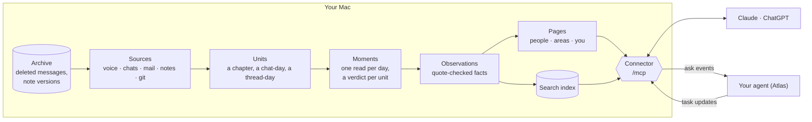

<div align="center">


# Life

**A private, self-running memory of your life, built on your Mac from your own voice, messages, mail and notes.**

[](LICENSE)


</div>

<!-- screenshot: status page with demo data -->

## What it is

Life reads what already happens on your Mac (recorded conversations, WhatsApp, iMessage, Beeper, Mail, Apple Notes,
your git commits) and, every night, turns it into a memory: what happened each day, who the people around you are,
how things stand in each part of your life. Every line it writes cites its source.

Then you ask. Claude or ChatGPT reads the memory through Life's connector, so "what did I promise my landlord last week?" or
"where are we with the flat?" gets an answer with the evidence attached.

**Your data stays on your Mac.** The memory is plain text in a git repository of its own, with no remote: Life commits
to it every night and never pushes. Raw messages stay in their apps. Model calls run on your own Claude or Codex
subscription, with no tools and nothing but the prompt.

## Features

- **Every channel, one memory.** Voice (through [lifelog](#requirements)), WhatsApp, iMessage and SMS, Beeper (LINE,
  Telegram, Instagram), Mail, Apple Notes, git, and one-time imports of your claude.ai and ChatGPT history.
- **People and area pages**, rebuilt as things change, each line cited and checked against its source. Close people
  get a "Between us" section that does not age.
- **An archive of what gets deleted:** messages deleted for everyone and every version of your notes, kept locally.
- **Search and reads** for any assistant: `search`, `day`, `person`, `chats`, `places`, `fetch`, over MCP or the CLI.
- **"Hey Atlas":** say it to hand a request to your own agent; Life tracks it as a task until it is done.
- **Reminders,** on your explicit request only, every change logged (optional plugin).
- **A status page** that shows each part of the pipeline live, and a **check page** to rate what Life believes.
- **Runs itself:** a nightly run, two midday passes, a daily encrypted backup, and an email (or notification) report.

## How it works



- **Units** are cut by code; one model call per day reads every unit of the day across every channel, in time order.
- **Observations** are what extraction keeps, each with a verbatim quote checked against the source.
- **Pages** are the one compressed layer: small enough to read, every line cited.
- **The connector** is an MCP server on your Mac, reached through your tailnet (or Tailscale Funnel for cloud
  assistants), behind your sign-in.

More in [docs/architecture.md](docs/architecture.md).

## Requirements

- macOS 14 or later on Apple silicon, with Full Disk Access for Life (to read Messages, Mail and Notes).
- One model engine: a Claude or ChatGPT (Codex) subscription, or an Anthropic or OpenAI API key.
- Optional: lifelog for voice, Tailscale to reach the connector from other devices, Resend for email reports,
  [remctl](https://github.com/viticci/remctl) for Reminders.
- To build from source: [Bun](https://bun.sh) 1.4 and Xcode's command line tools.

## Install

Prebuilt, notarized releases of Life.app are not published yet. Build it from source:

```sh
git clone https://github.com/eric-edouard/life.git
cd life
bun install
bun scripts/app.ts          # builds dist/Life.app (ad hoc signed without LIFE_SIGN_IDENTITY)
open dist/Life.app
```

The app's first run asks who you are, which engine to use and which sources to read, and guides you through Full Disk
Access. It then runs Life in the background from the menu bar.

## Usage

- **Connect an assistant.** The app puts Life on your tailnet (from a checkout: `bun life connect`, with `--public`
  for ChatGPT and Claude.ai through Tailscale Funnel). Add `<your connector origin>/mcp` as a connector (for example
  `https://my-mac.example.ts.net/mcp`) and approve it with a pairing code (`bun life pair`).
- **Status page:** open it from the menu bar, or at `<your connector origin>/`.
- **Check page:** `<your connector origin>/check` shows statements Life holds; swipe true, false or outdated, and the
  memory corrects itself.
- **Your agent:** paste the one sentence from [docs/agent.md](docs/agent.md) ("Set up once") into its instructions.

## Development

```sh
bun install
bun run check                 # lint, types, tests, scrub and case checks: the gate before every commit
bun test src/memory/units.test.ts
bun life <command>            # the CLI, run from the checkout (src/cli.ts)
```

- Tests use made-up data (`src/test-data`), each run in its own temp folder.
- `LIFE_DATA` and `LIFE_STATE` point a checkout at a copy of the data; never experiment on live data.
- Building and signing the app: [app/README.md](app/README.md); releases: [docs/releasing.md](docs/releasing.md).
- Contributor and agent rules: [AGENTS.md](AGENTS.md).

## Docs

| | |
|---|---|
| [Architecture](docs/architecture.md) | The pipeline, the lifelog split, why memory stays local, relationships |
| [Schema](docs/SCHEMA.md) | Every file in `memory/` |
| [Sources](docs/sources.md) | What each source reads and how |
| [Atlas and the connector](docs/atlas.md) | Asks, tasks, Reminders, the connector's tools, the only sends |
| [Operations](docs/operations.md) | Schedule, locks, backups and restore, evals, the read CLI |
| [Dashboard](docs/dashboard.md) | The status reads and the status page |
| [Releasing](docs/releasing.md) | Signing, notarization, Sparkle |

## Security

Life holds the most private data you have. Its threat model, its known risks (your agent runs outside Life's boundary)
and how to report a vulnerability: [SECURITY.md](SECURITY.md).

## License

[MIT](LICENSE)
