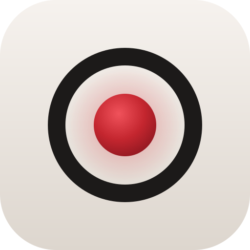
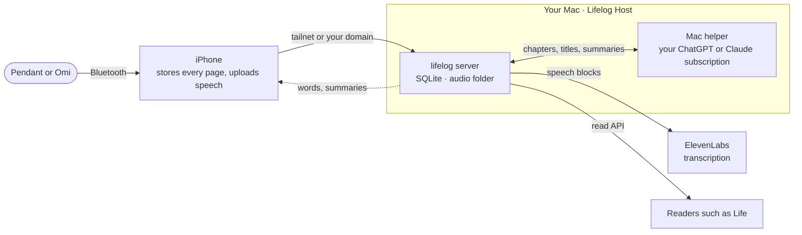

<div align="center">

<picture>
  <source media="(prefers-color-scheme: dark)" srcset="docs/assets/icon-dark.png" />
  
</picture>

# lifelog

**Everything your wearable recorder hears, kept safe on your iPhone and turned into conversations you can find, read
and replay, with the server on your own Mac.**

[](LICENSE)


</div>

<!-- screenshot: the Pendant screen and a conversation, with the simulator's demo library (-fixtureLibrary) -->

## What it is

lifelog replaces the companion app of a wearable recorder (a Limitless Pendant, or an Omi) with one you control. The
iPhone drains the recorder over Bluetooth, keeps every page on the phone before the recorder may delete it, and
uploads only the speech. A small server on your Mac transcribes it, groups it into conversations, recognizes who
spoke, and writes chapters, titles and summaries with your own ChatGPT or Claude subscription.

It is built for real days: distant voices, street noise, several languages in one sentence (English, French and Thai
are what it is tuned on), and a phone that is often offline. It never says it is recording when it can't prove it,
and it never pays twice for the same audio.

## Features

- **The Pendant screen:** is it recording, is the audio safe, what is still on the device, with honest "last known"
  states when the phone can't see it.
- **A library of conversations by day,** with transcripts in capture time, speakers, places, chapters and summaries,
  searchable by keyword offline and by meaning online.
- **Listening that follows the words:** the transcript lights as audio plays; tap a line to jump there.
- **Who spoke:** speaker recognition that only learns from your own answers, and one short list of voices to name.
- **The recorder's button:** one press transcribes the last minute and hands it to Claude or ChatGPT.
- **Dictation stays out:** when you dictate to your Mac, the recorder hears it too; lifelog keeps that audio but never
  sends it to a transcriber or a model.
- **Glances:** widgets, Control Center, Shortcuts and a Watch app, each showing the recorder's last report with its
  age.
- **Your data, portable:** an open export format, encrypted daily backups of the server, and a read API for other
  programs such as [Life](https://github.com/eric-edouard/life).

## How it works



- The phone acknowledges a page to the recorder (which then deletes it) only once the page is on disk and fsync'd.
- Speech goes up in fragments; the server closes them into short blocks, sends each block to ElevenLabs once, and
  places every word back in capture time.
- Summaries run through the Mac helper on your own subscription, in an empty folder with no tools. When the Mac is
  away, they wait; there is no paid fallback.
- The phone keeps a local copy of everything it shows, so every screen opens at once, offline.

More in [docs/architecture.md](docs/architecture.md).

## Requirements

- An iPhone on iOS 27, and a Limitless Pendant or an Omi (firmware 3.0.20 or later; read the Omi's
  [custody warning](docs/research/omi.md) first).
- A Mac that stays on, on macOS 15 or later, for the server.
- An [ElevenLabs](https://elevenlabs.io) API key (transcription is billed per hour of speech).
- A ChatGPT subscription with the Codex CLI, or a Claude subscription with Claude Code, for summaries.
- A way for the phone to reach the Mac: [Tailscale](https://tailscale.com) on both (free), or a domain on Cloudflare.
- Optional: an OpenAI API key for search by meaning; the [identity service](apps/identity) for speaker recognition.
- To build: Xcode 27, [XcodeGen](https://github.com/yonaskolb/XcodeGen) 2.46+, [Bun](https://bun.sh) 1.4, Homebrew's
  `librsvg`, and an Apple developer team to sign the app.

## Install

Build both from source (prebuilt, notarized releases are not published yet). The commands below run from Life's root.

```sh
git clone https://github.com/eric-edouard/life.git   # lifelog lives in Life's repo, in apps/lifelog
cd life
bun install
```

**The Mac: Lifelog Host.**

Build it with `bun run host:app`:

```sh
bun run host:app            # builds apps/lifelog/.build/host/Lifelog Host.app (ad hoc signed without LIFELOG_SIGN_IDENTITY)
```

Move it to Applications and open it. Settings opens until lifelog is set up: paste your ElevenLabs key (and OpenAI's,
if you want search by meaning), choose how your phone reaches the Mac, then **Start fresh** or **Import an export…**.
Under **Summaries**, sign the Mac helper in to your subscription: ChatGPT in the browser (the app carries its own
Codex), or Claude by pasting the token `claude setup-token` prints. Turn on the daily backup to iCloud Drive and
keep its password somewhere safe.

**The iPhone.**

```sh
bun run ios:project         # generates apps/lifelog/apps/ios/Lifelog.xcodeproj
```

Set `DEVELOPMENT_TEAM` and `LIFELOG_BUNDLE_ID` in `apps/ios/project.yml` to your own (every id derives from the bundle
id), open the project in Xcode, pick your iPhone and run the `Lifelog` scheme. Then point the iPhone's Camera at the QR
code in Lifelog Host's Settings to pair it, and pair your recorder from the Pendant screen.

## Usage

- **Status at a glance:** the ring in the Mac's menu bar says "all good" or what to look at; **Open status…** shows
  the whole pipeline, the archive's checks and each process's log.
- **Pause processing:** Settings → Processing on the phone (transcription and AI, each on or off).
- **Switch the summary engine:** Settings → Processing → AI model on the phone, or Summaries in Lifelog Host.
- **Connect a reader:** `bun run --cwd apps/lifelog/apps/server mint-token read` prints a token for a program that follows your
  conversations ([docs/voice-source.md](docs/voice-source.md)) and its hash: put `READ_TOKEN_HASH=<hash>` in
  `~/Library/Application Support/lifelog/server.env`, then Save in Lifelog Host. For Life, Lifelog Host's "Copy Life's
  lifelog settings" does it all.
- **Export everything:** Lifelog Host → Export everything…, or the phone's export
  ([docs/formats.md](docs/formats.md)).

## Development

```sh
bun run check                                # lint, types, every test suite, openapi, scrub, a Debug app build
bun run fix                                  # format
bun run --cwd apps/lifelog/apps/server test src/feed.test.ts
swift test --package-path apps/lifelog/apps/ios/Kit --scratch-path .build/kit
bun run --cwd apps/lifelog/apps/server dev                # the server from a checkout, with apps/lifelog/apps/server/.env (see .env.example)
```

In the simulator, Debug builds take `-fixtureLibrary` (a demo library with audio), `-fakePendant <scenario>`
(`healthyRecording`, `offlineBacklog`, `paused`, `busyElsewhere`, `bluetoothOff`, `corruptPage`,
`disconnectMidDrain`, `neverSetUp`) and `-offline`. None of them exist in Release builds.

Contributor and agent rules, with the invariants no change may break: [AGENTS.md](AGENTS.md).

## Docs

| | |
|---|---|
| [Architecture](docs/architecture.md) | The pieces, who owns what, how a page becomes a chapter, where a feature goes |
| [Decisions](docs/decisions.md) | The choices that shape lifelog and why |
| [Sync](docs/sync.md) | What the phone, the server and the Mac each own, and the feed |
| [Processing](docs/processing.md) | From speech to words, conversations, speakers and summaries |
| [Transcription server](docs/transcription-server.md) | Jobs, paying once, running the server, export and backups |
| [Pendant](docs/pendant.md) | The Bluetooth protocol, the drain, ACK and the button |
| [Timeline](docs/timeline.md) | Capture time, the speech rules and grouping |
| [Formats](docs/formats.md) | The export format and the raw backup |
| [Providers](docs/providers.md) | What each outside service sees and keeps |
| [Voice-source contract](docs/voice-source.md) | The read API for other programs |
| [Design](docs/design.md) | The look and each screen |
| [Lifelog Host and the Mac helper](apps/mac-quiet/README.md) | Setup, backups and restore, how it runs |

## Security

lifelog holds recordings of your life and of the people around you. Its threat model, where data and secrets live,
and how to report a vulnerability: [SECURITY.md](SECURITY.md). Recording people may need their consent where you live.

## License

[MIT](LICENSE)
