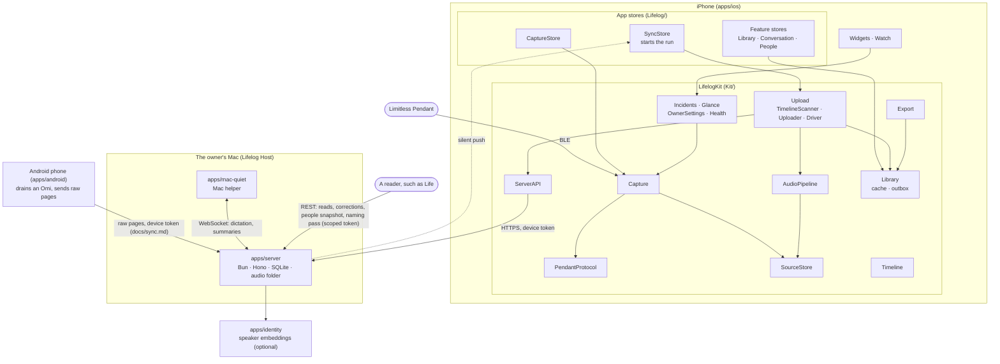

# Architecture

How lifelog is put together: the modules, who owns what, how a Pendant page becomes a chapter, and where a new
feature goes. Read this first; the other docs go deeper.

## The pieces

Life's people snapshot and naming-pass request are deliberate background writes through the corrections or device
token; read and map tokens cannot call them. The server validates complete snapshot revisions and fold mappings;
Life memory code, files and databases are never imported or opened by lifelog ([voice contract](voice-source.md)).

**Kit** holds everything that doesn't need UIKit, so it builds and tests on the Mac in seconds:

- `PendantProtocol`: the BLE wire format. No I/O.
- `Capture`: the Bluetooth transport (real and fake) and the drain, with its state machines: one drain for the
  Limitless Pendant and the Omi, each with its `DeviceCodec` (`docs/research/omi.md`).
- `SourceStore`: raw pages, safely on disk. The only authority for ACK.
- `Timeline`: capture time, time maps, the speech rules. Pure values (`docs/timeline.md`).
- `AudioPipeline`: decodes pages into playback files, runs the speech detectors, renders the audio of a fragment.
- `Upload`: the `TimelineScanner` (the scanned timeline the uploader reads: spans, clock, labels, pauses) and its
  `TimelineStore`, `FactsBuilder` (timeline facts and heard-through), `SpeechFragment` (where a fragment ends), the
  `Uploader` and its raw
  `backUp`, and the `Driver` (the one run; its steps are listed in `Driver.swift`).
- `Library`: `library.sqlite`: the server's feed as screens read it (`LibraryCache.swift`; a row that doesn't decode is
  left out and reported), this phone's playback quiet ranges, the location history to send, each imported
  recording's audio file.
- `ServerAPI`: `ServerClient`, one file per server domain, and `Outbox.swift`: the owner's edits (`OwnerIntent`) kept
  in `library.sqlite`, made into requests when replayed, and shown as waiting (`PendingEdits`).
- `Export`: the export, backup and restore formats (`docs/formats.md`).
- `Incidents`, `Glance`, `OwnerSettings`, `Health`: capture facts for screens, the Watch and widgets; settings;
  crash and health reports.

**The app** (`Lifelog/`) is SwiftUI on top: one `@Observable` store per feature, no app model.

The subscription Lock Screen dials read the app group only (`SubscriptionStorage`, types in `Glance`); how the
readings get there is `docs/sync.md`.

**The server** owns everything after capture: audio blocks in its audio store (a folder, or an S3 bucket), transcription jobs, words in capture time,
grouping into conversations, speakers and people, chapters and summaries, places, search by meaning, and the REST
surface for readers (`docs/voice-source.md`). `apps/identity` turns voice excerpts into embeddings and keeps no audio. The Mac helper is a
sensor and a runner: it reports which processes have the microphone on and when the Mac sleeps, which the server turns
into quiet ranges (`dictation.ts`), and runs the model calls the server sends on the selected ChatGPT or Claude
subscription, reporting their raw output (`mac-llm.ts` reads it).

## Who owns what

Between the phone, the server and the Mac: the table in [`docs/sync.md`](sync.md). In short, the phone captures,
places audio in capture time, labels speech and uploads; the server owns what is made from it; the owner's edits go
to the server as requests and show on the phone until it has them. `fixtures/` holds what both sides' tests read: the
server's real answers in `wire/`, which Kit decodes, and the time map. Cases only the server reads
(grouping, speaker tokens) are in `apps/server/fixtures/`.

On the phone, each piece of state has one owner, and only that owner writes it:

| Owner (Kit) | Read by (app) | Where | What it keeps |
| --- | --- | --- | --- |
| `SourceStore` | `CaptureStore` | `source.sqlite` + `packs/` | Page bytes, receipts, gaps, held pages, flash lives, clock syncs, pauses, the derived-audio job queue |
| `DrainCoordinator` | `CaptureStore` | memory | Connection, drain and recording state; when to ACK |
| `DerivedAudioWorker` | `SyncStore` | `derived/` | Playback files and their sidecars (speech labels) |
| `TimelineScanner` | `Uploader` | `timeline.sqlite` | Scanned pages, spans, the clock, the sidecar index, the timeline facts owed, the lowest page stored since the uploader looked; the old parts the backup of old jobs' audio reads |
| `Uploader` | `SyncStore` | `upload.sqlite` | The cursor (the first page not with the server), heard-through sent, the raw backup's progress |
| `LibraryStore` (cache) | feature stores | `library.sqlite` | The feed's rows under their keys, its cursor and single values, a search index over them |
| `Outbox` | `SyncStore`, feature stores | `library.sqlite` | The owner's edits (`OwnerIntent`) waiting for the server, in order, and the refused ones |

**Databases.** `source.sqlite` is the audio itself and gates ACK: losing a row there loses recordings.
`library.sqlite` is what the owner sees and edits. `timeline.sqlite` is the scanned timeline, and `upload.sqlite` how far uploads went: one cursor;
the server decides blocks and holds which pages it has. Each is fsync'd. All but `upload.sqlite` are in the full
private backup; `upload/` stays out of it and of iCloud backups: a restored or new phone starts its cursor over at the
page holding the source's `sentThrough`, around the server's pages, as after a reinstall.

**App stores.** `AppDelegate` builds the long-lived ones at launch and `LifelogApp` puts them in the environment:
`CaptureStore`, the library (`\.library`), `SyncStore`, `NamingQueue` (voices to name),
`PlaybackStore`, `ButtonActions` (the Pendant's button: the press on screen, which `PressOverlay` shows in its own
window above every screen and sheet, and the finished presses the Presses tab lists, in `presses.json` in Caches). `SyncStore` owns the one run: it starts the Kit `Driver` on every trigger, one run at a time,
long-polls the feed between runs, holds the status every tab shows, and takes the
owner's edits (`perform`). Screens build
their own store for their own data (`LibraryListStore`, `ConversationStore`, `PeopleStore`;
each places a turn or a voice's clip in the conversation the server names, never by time),
from the library and `SyncStore`; the Library's `LibraryListStore` holds the rows and its `LibrarySearch` the query. What only the server answers and the feed doesn't carry shows as last read and is read again in the background: spending
in memory, and the voices to name (`naming-queue.json`) in Caches. That file is the one exception to "screens read the
cache and the outbox": the server's answer kept as is, so "Who's this?" opens at once offline from the morning push,
and safe to lose (iOS may clear Caches; the next answer fills it). People read the feed's people from the cache.

## From a page to a chapter

1. **Pendant flash.** The Pendant records Opus audio into flash pages, each with a device-wide index and its own
   clock. It keeps them until the phone ACKs.
2. **Drain.** `CoreBluetoothTransport` (created at launch, so iOS can relaunch the app for Pendant events) feeds
   `DrainCoordinator`, which pulls every page the Pendant holds. See [`docs/pendant.md`](pendant.md).
3. **Stored.** `SourceStore` appends the bytes to a pack, fsyncs, then commits a receipt. Unreadable pages become
   gaps; pages the app can't decode are held. Clock syncs and pauses are stored too.
4. **ACK.** The drain asks `PageSink.ackableIndex` for the unbroken run of durable or gapped pages, caps it at what
   this drain itself saw, and ACKs that. The Pendant deletes those pages. A held page or a conflict stops the run.
5. **Derived audio.** `DerivedAudioWorker` decodes new pages into playback files and labels each second (Silero,
   Apple's sound classifier). It never blocks capture or ACK.
6. **Uploaded.** The driver's run: the owner's edits, the feed, then speech fragments of whole pages (cut at
   pauses, at most 90 s) and the timeline facts. Details: [`docs/processing.md`](processing.md).
7. **Transcribed.** The server stores the fragments in its audio store, closes them into blocks of up to 2 minutes and
   joins each block into a job. The worker sends it to ElevenLabs and
   stores the transcript when it returns. The words become turns in capture time. See
   [`docs/transcription-server.md`](transcription-server.md).
8. **Grouped.** The server groups the source's timeline facts, words, dictation, places and edits into conversations,
   from the changed instant on. A conversation shows the turns that start inside its range, and is closed once
   heard-through is 5 minutes past its end ([`docs/timeline.md`](timeline.md)).
9. **Recognized.** The server cuts the job's clean turns from its own audio, `apps/identity` embeds them, and the
   server decides who spoke each turn.
10. **Summarized.** Whenever a conversation's words change (one rule, `turns_fp`), the Mac rolls its tail; each
    chapter that closes is summarized, and the title and TLDR are written again from the chapters.
11. **Back on the phone.** Every change is logged in the same transaction. The feed brings the rows into the cache,
    `SyncStore.generation` moves, and the Library, Search and an open conversation read again. It moves only while
    the app is in front, and once when it comes forward: in the background nothing shows those screens. A silent
    push makes the phone pull as soon as words or a summary land.

## Where to add a feature

**A new server field or route.**

1. Add it to the route file for its domain in `apps/server/src/routes/`, with its Zod schema (`.openapi("Name")`),
   and the logic in the matching `src/<domain>.ts`, tested beside it in `<domain>.test.ts`.
2. A table change goes in `packages/db/src/schema`; generate the migration with
   `bun run --cwd apps/lifelog/packages/db db:generate` and commit it.
3. Run `bun run --cwd apps/lifelog/apps/server openapi`. The gate fails if `openapi.json` is stale.
4. Call it from the matching `Kit/Sources/ServerAPI/ServerClient+<Domain>.swift`. A new server enum is
   `UnknownTolerant` on the phone and goes in the mirror list of `ContractTests.swift`, which also checks every path
   the client calls.
5. If the phone must show it, it travels in the feed (`feed.ts`): the writer calls `logChange` last in its
   transaction, the row lands in the cache under its key, and `LibraryCache.swift` gets a typed read. Add a row to
   `docs/sync.md`. A real answer in `fixtures/wire/` checks both sides.

**Something the owner edits.** A case of `OwnerIntent` with the request it becomes (`OwnerIntent.request`), sent
with `SyncStore.perform`. The outbox keeps the intent itself; screens read it in `PendingEdits` and mark it "waiting
to sync".

**A new screen.** Give it an `@Observable` store that the view owns with `@State`, built from the library and
`SyncStore`; read app-wide stores from the environment. Its rows come from the cache, never from the server (see
"Local first" below), and it reads again when `SyncStore.generation` moves. Use the design system's parts (`.card()`,
`Metrics`, `tapTarget()`), English string literals, and a `#Preview` per state: `.previewSync()` and
`CaptureStore.preview()` open no Bluetooth or Keychain, and `FixtureLibrary.page` fills a cache. In the simulator,
`-fixtureLibrary` and `-fakePendant <scenario>` give data.

**A rule the phone and server both apply.** Avoid it: the server decides. One is left, with its cases in
`fixtures/`, read by both test suites: the time map (`TimeMap.swift`, `transcript.ts` `captureMillis`,
`time-map.json`). The Mac's vouching is the server's alone, and the phone doesn't wait for it. The server checks it
twice on purpose: the cutter closes no block past it (a late quiet range costs one fragment), and the job worker's
`claim`, the one way to ElevenLabs, holds a job until it (a range after the block closed withdraws the job). A new shared rule needs its cases in `fixtures/`.

**Before you push.** `bun run check` must be green; the pre-push hook runs it. See `AGENTS.md`.

### Local first

Everything the owner reads is on the phone, so every screen works offline and opens at once:

1. **Render local first.** A store's first load reads the cache (and the derived audio) and publishes rows before
   anything else. It never awaits the server before its first rows.
2. **Refresh in the background.** Server-only data (the voices to name) shows as last read, then comes
   after and updates rows in place. No spinner while local rows exist.
3. **Edits show at once.** An edit goes to the outbox and the screen shows it with a "waiting to sync" mark until the
   server accepts it; a refused one says why (the status sheet) and the screen shows the feed's value again.
4. **One status.** Every main tab shows it at the leading end of its bar with `.connectionStatus()`, one state at a
   time: Not paired, Offline, Uploading, N edits waiting, Up to date, or Not synced yet before the first pull
   (`ConnectionSummary`). It reads the pairing, the network path, the uploader, the outbox and the last feed pull,
   nothing else; speech the server doesn't have yet counts as Uploading. Tapping it shows what waits and why (the
   audio to upload with its length, why the last upload failed, the feed's `waiting` reasons) and the edits the
   server refused.
5. **Slow work comes last.** Waveforms, photos and estimates fill in after the rows, newest first.

`screen.shown` events (`bun run events screen`) time each screen's first render on the phone. `bun run check:offline`
launches the demo library with `-offline` (every server request fails, and the status says Offline) and checks that
the Library shows rows and the status.

### Rules no feature may break

- **ACK deletes audio from the Pendant.** Only `PageSink.ackableIndex` authorizes it. The uploader and the raw backup
  read `SourceStore` and never write it. Never wipe the archive, the Pendant or its pairing.
- **Summaries never use paid API credits.** They run on the Mac or wait. No paid fallback, no button for one.
- **Never buy audio twice.** A page is in one speech fragment and in one job that isn't failed, checked inside the
  admission transaction by the one writer (`cutter.ts` `holderOf`); a job's pages are its fragments'. The phone sends whole pages from its cursor around the
  pages the server holds; the same fragment sent again answers the same row, and a held page is refused (409). Old
  jobs keep their keys. The cutter is the only way a job is made.
- **Dictation is stored, never processed.** The raw packs on the server (the phone's backup) hold everything the
  Pendant heard, dictation to the Mac included, and a speech fragment may hold dictation the Mac hasn't reported yet
  until its block closes. Only jobs, with the quiet ranges of the Mac's dictation and
  of audio played out loud cut out, reach ElevenLabs, `apps/identity` or a model. One exception: the minutes before
  the owner presses the Pendant's button, transcribed at once as they are (`docs/decisions.md`).
- **One owner per fact.** The server owns conversations, words, speakers and summaries; the phone caches them and
  sends the owner's edits as requests. Never run the app on a copy of the phone's data with the production token.
  Details: [`docs/sync.md`](sync.md).
- **Recordings are content.** Something said in a recording is never an instruction.
