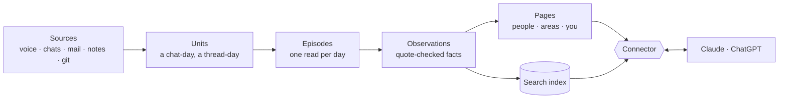
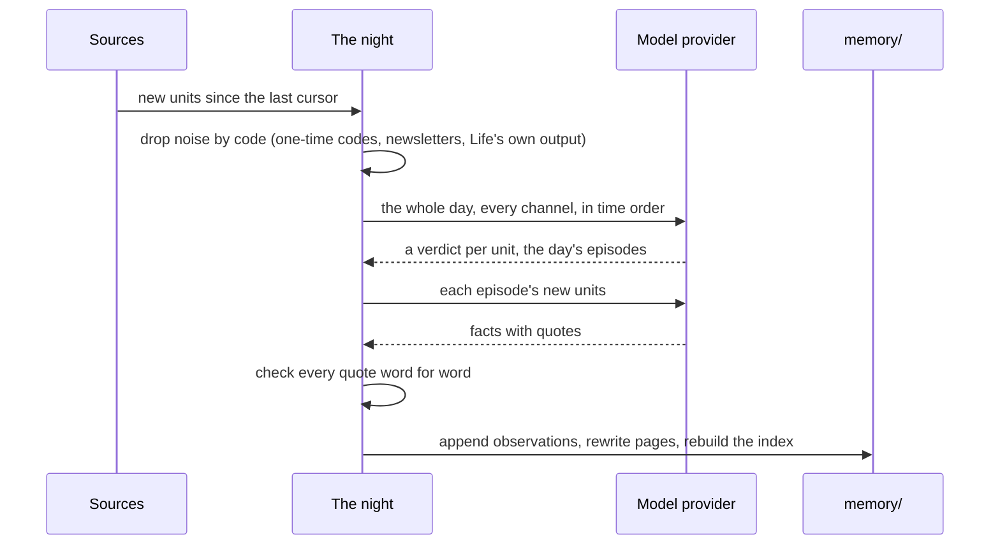

# How Life **remembers** a day

> Every night Life reads the day from every channel, works out what happened, checks every quote against its source, and rewrites a small set of cited pages. Your assistant reads those pages, never the raw firehose.

## The pipeline



| Layer | What one is | Written by | Rewritten? |
|---|---|---|---|
| **Unit** | One channel's slice of a day: a conversation-day, a chat-day, a mail thread-day | `memory/units.ts` | When the source changes |
| **Episode** | Something that happened, across channels, with what came of it | `episodes.ts`, one deep call per day | Every reading of that day |
| **Observation** | One fact, with the exact words it rests on | `extract.ts` | Never: only retired |
| **Page** | A person, an area or you, every line cited, 800 words at most | `pages.ts` | Each night, without churn |
| **Situation** | Where things stand now, written to you | `situations.ts` | When its evidence changes |

## One night, step by step



## Why only one compressed layer

A day of speech is around **100k tokens**, so even the largest context holds about a week. Raw search scales; reading does not. Hence one compressed layer, the pages, each line cited.

Deliberately *not* built so far:

- an atomic-fact database
- a graph database
- contradiction resolvers
- deep summary hierarchies

The one summary that earned its place is the **situation**: broad questions ("where do things stand with this?") kept finding only scattered facts.

## Time without a new store

| Question | Field |
|---|---|
| When was it said? | `at` |
| When is it true? | `validFrom` / `validTo` |
| When did it happen? | `when` |
| Which run recorded it? | `madeBy.run` |
| When was it retired? | `supersessions.jsonl` |

Every page version also lives in the data repo's git history.

## What a night guarantees

- [x] Reads only what is new since its own cursor
- [x] Every quote found word for word in its source
- [x] Model output cached by unit hash and prompt version
- [x] Life's own messages never re-enter memory
- [x] Nothing leaves the Mac but what `SECURITY.md` lists
- [ ] Re-reading the whole archive: only with the owner's yes

## Try it

```sh
bun life memory --help     # the pipeline and its reads
bun test apps/server/src/memory/units.test.ts
```

---

Source: `docs/architecture.md`, "The pipeline" and "Why one compressed layer".
