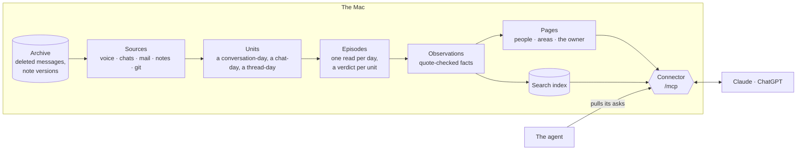

# Architecture

Explanation: how Life is built and why.

Life is a memory of one person's life, built from their own sources and kept on their own Mac. This page explains its
shape and the reasons for it. Record formats are in `docs/SCHEMA.md`, sources in `docs/sources.md`, the agent and the
connector in `docs/tasks.md`, how it runs in `docs/operations.md`.

## lifelog and Life

Life works beside lifelog, a companion project that captures voice. Each has one job:

| | lifelog | Life |
|---|---|---|
| Job | Voice capture: audio, transcripts, speakers, conversations, search | Memory across sources: voice (through lifelog), WhatsApp, LINE, Instagram, Messenger, LinkedIn, Telegram, iMessage, mail, Apple Notes, git, imported assistant chats |
| Owns | The raw spoken archive | The people across channels, observations, people and project pages |
| Runs | Its own host and the phone | The Mac (WhatsApp, Messages and Mail are Mac-only, and chats stay on the Mac) |
| Acts? | Never | Only on the owner's clear request (`docs/tasks.md`) |

- Life reads lifelog through its REST API with a device token (`apps/server/src/sources/lifelog.ts`): the change feed
  into a small store of who spoke when, never the words (except an ask's), and a turn's words, search and places on
  demand.
- Life builds its voice units from lifelog's conversations and their turns, by code; lifelog's summaries are never
  read. The chapter units already stored stay as they are: facts, his ratings and corrections cite them.
- Life writes to lifelog in two ways only: `forward`, the owner's explicit corrections (speaker, title, rename, merge),
  and `notifyPhone`, a "heard you" push for each voice ask (no words of his).
- Memory does not move into lifelog: memory about one person comes from voice, chats and mail together, and chats must
  not leave the Mac, nor their text go to a third party for embeddings. Life embeds its own texts with the embedder
  Lifelog Host runs, on loopback (`memory/vectors.ts`): the one call to lifelog's side outside its REST contract.

## The pipeline



- **Sources** (`apps/server/src/sources/`, one descriptor each in `apps/server/src/memory/sources.ts`) return records (`SourceEvent`) with stable ids, so reading
  twice never duplicates anything. Raw data stays in its own app.
- **Units** (`apps/server/src/memory/units.ts` only, through `gather`): a conversation-day, a chat-day, a mail thread-day, a
  note-day, a repo-day. Code drops obvious noise (one-time codes, newsletters, Life's own output, mail from no one he
  knows) before any model sees it.
- **Episodes** (`episodes.ts`): one deep model call per day reads the day from every channel in time order, with where
  his phone stayed: the units not judged yet in full, the rest as stubs, and the day's episodes as they stand. It writes
  a verdict per new unit (type, importance, area) and the episodes new, changed or gone: only what happened, each with
  `what` came of it and the episode holding it (`within`). The same call says who the day's unknown people are
  (`memory/people-inferred.jsonl`, used at once, corrected later); before it, the night names the senders his
  Contacts know (`memory/people-contacts.jsonl`, by code, read above any guess: `contact-people.ts`). A conversation-day's text is its words, fetched
  only for the units sent in full (`voiceText`). Nothing is cut (his request of 9 Nov 2026): a day too long for one
  call (`callCharsOf`, the provider's context) is read in parts, in time order, through the same re-read; a mail is
  its own words, the history it quotes left out (`ownWordsOf`). Apple Health and Photos units can make episodes: each workout
  and night has its own bounds, a photo-day its lines of photos at a place (with a local model's description of each photo, `models/describer.ts`; each photo is also a search passage). They remain activity (`isActivity`): never extracted, importance at most 1.
  Like other episodes, they become Past calendar events and memory claims; episodes are never drawn for fact checks.
- **Observations** (`extract.ts`): extraction reads an episode's units together, with earlier facts shown as a reading to
  correct, never as evidence. Every quote is checked against its source (`quote-check.ts`). Extraction is the only step
  that retires an observation, besides the owner's word that one is outdated (a fact-check answer or an `outdated`
  correction).
- **Pages** (`page-format.ts` pure, `pages.ts` orchestration): the people and area pages, every line cited, no churn, 800
  words at most (the owner's own page 2,000).
- **Situations** (`situations.ts`): where things stand now with him and each person close to him, read nightly by one
  call from the page, the persona (to say when the newest days repeat a known pattern or break it) and the last 30
  days' episodes, each line citing episodes. Rebuilt whole when its inputs change,
  never from its own last version, so it stays a projection; older days fade into the page's sections and History,
  and git keeps every version. A reader shows a line only while its episodes are live, the situation first; a search also shows,
  from the situations it doesn't show whole, the lines citing an episode it found.
- **Personas** (`personas.ts`): a gist first (his request of 9 Nov 2026), then what each person with a page is like, what they want and can give (and what goes each
  way between them and him), what keeps happening between them (both sides, his part named), and how each writes to the other, for an agent who reads them before he meets, calls or
  writes to them, or drafts for him; his own across everyone, with his own writing (his notes, his imported assistant
  chats; his request of 9 Nov 2026). One call per person reads what passed between them over
  3 years (his request of 8 Nov 2026: every raw source Life holds): their 1:1 messages both ways and the group
  chat-days they wrote in, his and their lines only (the night's read of chats and mail, `readWithPeople`, shared with
  closeness, which leaves groups out: a group is no measure of closeness, but it shows how someone is) and his
  recorded conversations where they spoke (the stored voice units, their words read only when the persona is due),
  every message whole: all of it when it fits one call (`callCharsOf`, his request of 9 Nov 2026: nothing cut), else
  sampled (the newest, then each month's most eventful days, year by year); a
  chapter from before conversation-days goes in by its words while lifelog holds its turns, else as its summary,
  context only. With their page and what code counts over
  the 1:1 messages (the exchange counts, below: who writes, deletes, opens, how fast each answers). Deleted messages are read like
  the rest, marked; a call is its call line. Each quote is found in a chat message or a recorded turn shown (a writing
  line's only in that writer's 1:1 chats) and kept with its time, so how well a line is backed (`supportOf`: solid on 3
  days or more, thin, old) is counted when read, never stored. Rebuilt whole at most weekly, when what was said
  changed. Psychology lives here only, in accepted terms (Big Five, values, attachment, Gottman's
  moves, social exchange) with the behaviour that shows it; pages stay facts.
- **The index** (`LIFE_STATE_DIR/memory/index.sqlite`): rebuilt from observations and units (`reindex`); the watcher rewrites only the rows of the units it rewrote in place (`reindexUnits`), and rebuilds it all when a unit went or a code rule dropped or took one back, or an input is newer than it (`readStaleness`); read by the CLI and the connector.
- **Histories** (`histories.ts`, `memory/histories/`, off until his `history` setting; shown in the person read: the story and the newest 12 months on its first page, the earlier months paged with its timeline): each closed month between him and someone with a page, summarised once from their one-to-one exchanges (the stream the exchange counts count, a call of 30,000 characters at most, a large month in parts), every quote found in a message shown and kept apart from the summary; then the story of the years through the last closed one. What is pending is derived each night from the stored hashes, the newest months first, 200 calls a night at most; the present month stays the situation's. Later inputs (episodes with them, photo-days, the focused reads) join as new keys of the same call.
- **Links** (`memory/links.ts`, `memory/links.jsonl`, in shadow: nothing reads them, off until his `links` setting): each night, after the index, one call per person is shown the open things with them (as open items find them) and the later observations about them, and says which later one shows an open thing ended. Code keeps a link only when both ends were shown, the later one is later, and its words are found in the later one's quote. Each judged batch is one appended line, which is also the record of what was judged, so due work is derived: the oldest first, 10 calls a person and 100 a night at most. The next step makes open items read the endings, with his word ("that's not done") above them.
- **Exchange reads** (`memory/exchange-reads.ts`, `memory/read-replies/<YYYY-MM>.jsonl`, off until his `exchangeReads` setting; stored, read by `bun life memory exchange-reads` and by nothing else yet): the three reads of an exchange (connection, mentions, conflict), for every finished exchange of his living one-to-one chats, in calls of 30,000 characters at most, one chat at a time. Each reply is one appended line, stored as given with what made it, the wording's digest and the keys of the messages it read; a new wording adds lines and rewrites none. What is pending is derived each night from the stored lines: an exchange is read by a read when a line of its current prompt lists it with exactly its messages today, so a grown exchange is asked once more and an unfinished one never. The newest 200 calls a night across the three reads.
- **Coverage** (`memory/coverage.ts`): whether a source that captures on its own was captured on a day, worked out when read from the units held, each source's first day, the day's units file, the record of what each publication read (`memory/publications.jsonl`, in his data because every worktree shares the units it describes) and, for the pendant, the recorded days (`LIFE_STATE_DIR/memory/recorded-days.json`, `memory/recorded-days.ts`: the local days lifelog says it recorded on, asked whole each night so no read waits on lifelog). Three states, never "quiet" by default: captured, not seen, unknown. `read_day` shows a day's; the person read says, by month, the days a source of theirs was not seen or unknown; the counts and the histories will count only captured days. Not yet known: an archive stopped under a running night, a bridge logged out.
- **The exchange counts** (`LIFE_STATE_DIR/memory/exchange-counts.json`, `memory/exchange-counts.ts`): what code counts between him and each person over their one-to-one chats and mail threads, one row per exchange (who opened, messages and deletions each way, minutes to each answer, its days). The sources are the truth: the night reads every year once and rewrites the file whole, and writes nothing when a source failed. The person read folds the rows by year; the persona folds the same rows over the messages it is shown. What code counts from the sources is derived state like this, never a file in `memory/` (decided 11 Nov 2026: it costs a minute and a half a night, and no invariant, migration or commit).
- **Move rates** (`memory/moves.ts`, `memory/move-rates.ts`, 13 Nov 2026; the replies they count are stored by the exchange reads; the person read does not show the rates yet): the three focused reads list coded moves for each exchange, and `moveRatesOf` counts them into rates for an agent to use as data, derived on each call, from the stored replies. A rate whose chance is an exchange is kept per source, never pooled; one whose chance is a move (a bid, a fault, a decision) is counted across sources. The minimum is 15 chances (`MINIMUM`); a reading's own higher bar is its reader's. "Lately" is the 12 local months before a month the caller passes, so people compare over one window. A share is said only of what `PROVEN` lists, the things that held on the test set against the reference model (kappa 0.5 or more on 30 cases or more); anything else is counted and never said, and a new code is exploratory until proven. The moves are never stored (`checkedMoves` works them out from a reply when read); the reply is (`records/read-reply.ts`).
- **The passages** (`LIFE_STATE_DIR/memory/passages.sqlite`): rebuildable source-backed search text, separate from the index. The first message's unit owns a passage, identified by source and first-message id. Reconciliation follows complete grouping runs across midnight and month boundaries; search and embeddings use these same rows, including imported assistant messages excluded from model reading. Ordinary reindex reads metadata only.
- **The vectors** (`LIFE_STATE_DIR/memory/vectors.sqlite`): normalized float32 vectors addressed by text hash, in partitions of at most 4,096 rows. Exact scans retain bounded best candidates per partition; an index rebuild never re-embeds. Each watcher embedding pass selects at most 256 missing hashes in SQLite, newest first, before loading their texts; arrivals precede historical backlog. Pruning compares stored hashes in SQLite, without loading the corpus. Episode search text lives in the rebuildable index.

Model output is cached by unit hash and prompt version, so a night re-reads only what changed.

### Why one compressed layer

Raw search scales; reading does not. A day of speech is on the order of 100k tokens, so the largest context holds about
a week. Hence one compressed layer, the pages, each line cited. Not justified so far: an atomic-fact database, graph
databases, contradiction resolvers, deep summary hierarchies. One summary is justified (his decision of 5 Nov 2026):
the situation, where things stand now, since broad questions ("am I still with her?") found only scattered facts. This limits memory structures, not initiative: raising things
unasked is the agent's job.

Time is modeled without a new store: said (`at`), valid (`validFrom`/`validTo`), event (`when`), recorded
(`madeBy.run`), retired (`supersessions.jsonl`), and every page version is in the data repo's git.

### The owner's own page

`memory/pages/people/me.md` (`OWNER` in `memory/read-truth.ts`) is built from the observations like every page, with its own
sections (`layoutOf`, `page-format.ts`), so changing its shape costs a rebuild of one page. `person me` adds the owner's goals,
read from `truth/me.md`.

## Relationships and closeness

A question like "what is my arc with this friend?" needs more than recent logistics. The design:

- **Who gets a page is a closeness level** (`apps/server/src/memory/closeness.ts`), judged by a model on numbers code counts from
  raw signals only (two-way 1:1 message days, voice presence, recency), never from model output, so there is no
  feedback loop. Personal and work closeness are separate scores. Service accounts are not people. Close family keeps a
  floor. The owner can override any level in a sentence; there is no list for the owner to keep.
- **A section that does not age:** close people's pages have "Between us" (role, agreements, boundaries, dynamics,
  turning points), each line cited and attributed; a line with no new evidence in 12 months moves to History.
  Close means close personally now or once, so a dip never empties the section.
- **Old facts can be corrected:** extraction also shows an episode the facts of the last year about the close people
  (`priorFor`), so a newer fact can retire an older one.
- **Arcs are assembled when asked** (the relationship section, History, paged evidence, episodes, a month timeline),
  never stored as a summary; the present is (the situation), and what keeps repeating is (the persona).
- **Names:** misheard and other spellings resolve to the person, and the Mac's Contacts name handles Life can't place.
- **Details** are only what is already a field (his map, then his Contacts: `detailsOf`, the one place for them and
  for a birthday). Everything else known about someone is a line of their page: models read prose, and a field earns
  its place only when code computes with it (a birthday, a handle). A model step that tagged facts as details (6–8 Nov
  2026) only copied page lines, and went.
- **What a model call is shown:** its context (the same for every call of a run, so it is cached) holds the people close
  to him now, personally or at work, and the projects underway (`refContext`, `contextPeopleBy`). Everyone else on the
  map comes in a call's input as `involved` when the call involves them: its units' people, the names their words use
  (`namedIn`), earlier facts' or episodes' refs (`involvedOf`). So a call stays small as the map grows by hundreds a
  year, and nothing is forgotten: replies are checked and names resolved against the whole map.
- **Historical collection:** `bun life memory historical-units` collects bounded owner-local months without models, voice writes or file descriptions, ending before the nightly window. Historical zones use the offsets of photos that place him and of sent mail; gap rules are in [operations](operations.md#historical-collection). Imports and model backfills require the optional `backfillEngine`; scheduled model backfill is paused until prompts are frozen. The night keeps the ordinary engine.

**Phone calls** are events of their chat, including call-only chats, never a second record: a call reads as a line of its chat-day ("(audio call
10:02–10:40, 38 min)"), and a voice lifelog heard over a phone, or nearby but not with him, reads with that prefix
(`heardAs`, words.ts), so the episodes call joins a call to what was said in the room by time and by how voices were heard,
never by a timing rule of Life's. Phone & FaceTime has its own `phone` source, read from the archive (see
[sources](sources.md)); messaging apps retain their own calls. A completed 1:1 call from any source sets the same
voice day as a recording in `chatDays`, once per person and local day, and never adds message weight. A call-only
chat resolves identity through its handles, never its display name. Voice attribution remains the model's reading.

Known limits: no Telegram calls, no unrecorded time together, no location history before lifelog's; a spoken claim about
someone else is capped at 0.6 confidence.

## Why the memory stays on the Mac

- The owner data dir is a local git repository with no remote: the nightly commits and never pushes.
- The archive (deleted messages, old note versions, phone call history, Screen Time's records) is the only live copy of what the apps delete or prune; it lives in
  Application Support and in the encrypted backup, nowhere else.
- The exception is the model: the text a step reads is sent to the provider of the chosen engine (Anthropic or
  OpenAI through the owner's subscription's CLI, or OpenRouter and allmodels.io with his keys: `docs/operations.md`, "Model engines"). Calls run in
  an empty temp folder with no tools and no instruction files, so recorded content reaches the model with nothing but
  the prompt. (A developer's benchmark, the question cases, gives one Codex call Life's connector, reads only.)
- The optional backup goes where the `backup` setting says (for example iCloud Drive), encrypted by restic.
- The connector is reached through the owner's tailnet (or a tunnel the owner controls), behind Life's OAuth.
  The owner's install is a bridge until #137: a Cloudflare Worker (`apps/edge/`) on every path of his public address passes
  each request as is to the Mac's Tailscale Funnel on port 8443 (HTTPS a VPN lets through, unlike the tunnel's 7844),
  so his connector's URL never changes. It decides nothing; the Mac's OAuth guards every path.

## The code

The server's code (`apps/server/src`) is in layers, and dependencies point one way:

```
core  ←  records  ←  models, sources, todo-list, payments  ←  memory  ←  host
```

| Folder | What it holds |
|---|---|
| `core/` | Clock (with calendar-day arithmetic, `daysBefore`), list cuts (`lists.ts`), paths and the platform, settings and Life's fixed names (`names.ts`), process, lock, log, secrets, redaction, hashing, small JSON files, which outputs are on |
| `records/` | Every record Life writes, as zod schemas, one file per record (`unit.ts`, `episode.ts`, `observation.ts`, `fact-check.ts`, `ledger-entry.ts`, `source.ts`), plus `truth.ts` and the fields they share (`fields.ts`) |
| `models/` | The model providers (`PROVIDERS`), the call and its cache |
| `sources/` | One reader per outside store, and the source contract (`contract.ts`) |
| `todo-list/` | The to-do list contract (`TodoListBackend`), its two backends and open items |
| `payments/` | The payments contract (`PaymentsBackend`) and its one backend, his `money` CLI |
| `memory/` | The pipeline (units, episodes, observations, pages), the ledger and its readers, people and places, search, the source registry (`sources.ts`, with the agent's own source) and the nightly email's rendering |
| `host/` | What runs, and the only layer that knows which host it is on: the jobs (watch, hear, archive, nightly, backup), the asks (`asks.ts`), `act` and `inbound`, the CLI and its commands (import, export, init, health), `http/` (the connector, the issuer, the brand), `status/` (the status snapshot, Life's status), and the outputs (report, the Past calendar, the appointments) |
| `test-data/` | The made-up data tests read |

What the check enforces is the order: no file imports a layer to its right, fallow's boundary zones (`.fallowrc.json`)
fail any that does, and `scripts/imports.test.ts` fails any import cycle. Within it, a capability's contract has its own
`contract.ts`. The layers are folders, not packages: a folder becomes a package only when a second app imports it.
The reasons are in the [architecture plan](plans/2026-10-22-architecture.md).

Connectors are built in, not loaded. Every source and to-do backend ships inside Life, behind its contract, and an
install turns on the ones it wants in its settings (`sources`, `todo_list`). That is what packaging Life for others
needs. A runtime plugin loader would let outside code run inside Life with all of the owner's data, and freeze the
contracts for code Life can't change, so it waits until someone outside Life wants to write a connector (decided
4 Nov 2026). Until then a new connector is one reader file and its descriptor in `SOURCES`.

The repo around it is a Bun workspace:

| Path | What it holds |
|---|---|
| `apps/server` | The code above, with its runtime dependencies. The helper (`scripts/helper.ts`) compiles it for Life.app |
| `apps/mac` | Life.app ([its README](../apps/mac/README.md)) |
| `apps/edge` | The Cloudflare Worker in front of the owner's public address, a bridge until #137 (deploy steps in `wrangler.jsonc`) |
| `packages/config` | The shared TypeScript base (`tsconfig.base.json`), which the root `tsconfig.json` extends |
| `scripts/` | The helper, the app build, releases, the check, the benches and evals. Outside the zones; they import the server as the workspace package `@life/server/src/…` |
| `prompts/`, `assets/` | The model prompts and what the pages, the app and the email show (`LIFE_CODE_DIR`, `docs/operations.md`) |
| `derived/` | Generated, gitignored: a checkout's state |
| root | `bts.jsonc` (so `create-better-t-stack add` works), `bunfig.toml` (a hoisted install, for Codex's binary), the workspace's version catalog |

No Turborepo: `bun run check` runs every step at once, and a task cache would buy two short steps. There is no CI: the pre-push hook runs `bun run check`.

## The app

`Life.app` (`apps/mac/`, SwiftUI, menu bar) is how Life is installed. It runs the compiled helper (`scripts/helper.ts`): the
archive and the watcher kept running, the nightly tick every 30 minutes, data and state under `~/Library/Application
Support/Life`, secrets from the Keychain. The app never reads Life's files: it asks the helper (`app`, `settings`,
`init`, `pair`, `connect`), so their shape lives in one place. It starts Life at launch. Updates come through Sparkle.
Its menu-bar panel and status window are native SwiftUI, reading the status snapshot from the watcher's local status reads
(`apps/server/src/host/http/status-reads.ts` on `LOCAL_PORT` (`http.ts`), behind its local key (`keyRefusal`, `local-key.ts`; `LIFE_STATE_DIR/local.key`, mode 600); no tunnel ever points
there): `docs/status-reads.md`.

## Pages

Life serves no web pages. The watcher's server serves the connector, its issuer and the brand, and none of the owner's
data before a token. Every route is a Hono app; `server.ts` mounts one app per port and `Bun.serve` only listens. The web
app and the legacy portrait (`/me`) were removed on 8 Nov 2026; the server version will build what it needs.

- **The brand** (`apps/server/src/host/http/server.ts`: `/docs/brand.md`, `/assets/brand/tokens.css` and the files they link), open to all: Life's
  own files, nothing of the owner's, for his agent to style what it makes for him.

Everything Life shows follows Life's brand, one source in `assets/brand/tokens.css`: where each surface takes it is
`docs/brand.md`.
