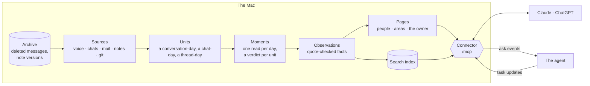

# Architecture

Explanation: how Life is built and why.

Life is a memory of one person's life, built from their own sources and kept on their own Mac. This page explains its
shape and the reasons for it. Record formats are in `docs/SCHEMA.md`, sources in `docs/sources.md`, the agent and the
connector in `docs/tasks.md`, how it runs in `docs/operations.md`.

## lifelog and Life

Life works beside lifelog, a companion project that captures voice. Each has one job:

| | lifelog | Life |
|---|---|---|
| Job | Voice capture: audio, transcripts, speakers, conversations, search | Memory across sources: voice (through lifelog), WhatsApp, LINE, Instagram, LinkedIn, Telegram, iMessage, mail, Apple Notes, git, imported assistant chats |
| Owns | The raw spoken archive | The people across channels, observations, people and project pages |
| Runs | Its own host and the phone | The Mac (WhatsApp, Messages and Mail are Mac-only, and chats stay on the Mac) |
| Acts? | Never | Only on the owner's clear request (`docs/tasks.md`) |

- Life reads lifelog through its REST API with a device token (`apps/server/src/sources/lifelog.ts`): the change feed
  into a small store of who spoke when, never the words (except an ask's), and a turn's words, search and places on
  demand.
- Life builds its voice units from lifelog's conversations and their turns, by code; lifelog's summaries are never
  read. The chapter units already stored stay as they are, so the voice history is not read through the models again.
- Life writes to lifelog only through `forward`: the owner's explicit corrections (speaker, title, rename, merge).
- Memory does not move into lifelog: memory about one person comes from voice, chats and mail together, and chats must
  not leave the Mac, nor their text go to a third party for embeddings.

## The pipeline



- **Sources** (`apps/server/src/sources/`, one descriptor each in `apps/server/src/memory/sources.ts`) return events with stable ids, so reading
  twice never duplicates anything. Raw data stays in its own app.
- **Units** (`apps/server/src/memory/units.ts` only, through `gather`): a conversation-day, a chat-day, a mail thread-day, a
  note-day, a repo-day. Code drops obvious noise (one-time codes, newsletters, Life's own output) before any model sees
  it.
- **Moments** (`moments.ts`): one deep model call per day reads every unit of the day from every channel in time order,
  writes a verdict per unit (type, importance, area) and what happened or is planned. The same call says who the day's
  unknown people are (`memory/people-inferred.jsonl`, used at once, corrected later). A conversation-day's text is its
  words, fetched only for the day being read (`voiceText`).
- **Observations** (`extract.ts`): extraction reads a moment's units together, with earlier facts shown as a reading to
  correct, never as evidence. Every quote is checked against its source (`observe.ts`). Extraction is the only step
  that retires an observation, besides the owner's word that one is outdated (a fact-check answer or an `outdated`
  correction).
- **Pages** (`page-format.ts` pure, `pages.ts` orchestration): the people and area pages, every line cited, no churn, 800
  words at most (the owner's own page 2,000).
- **The index** (`LIFE_STATE_DIR/memory/index.sqlite`): rebuilt from observations and units; read by the CLI and the connector.

Model output is cached by unit hash and prompt version, so a night re-reads only what changed.

### Why one compressed layer

Raw search scales; reading does not. A day of speech is on the order of 100k tokens, so the largest context holds about
a week. Hence one compressed layer, the pages, each line cited. Not justified so far: an atomic-fact database, graph
databases, contradiction resolvers, summary hierarchies. This limits memory structures, not initiative: raising things
unasked is the agent's job.

Time is modeled without a new store: said (`at`), valid (`validFrom`/`validTo`), event (`when`), recorded
(`madeBy.run`), retired (`supersessions.jsonl`), and every page version is in the data repo's git.

### The owner's own page

`memory/pages/people/me.md` (`OWNER` in `memory/read-truth.ts`) is built from the observations like every page, with its own
sections (`layoutOf`, `page-format.ts`), so changing its shape costs a rebuild of one page. `person me` adds the owner's goals,
read from `truth/me.md`.

## Relationships and closeness

A question like "what is my arc with this friend?" needs more than recent logistics. The design:

- **Who gets a page is a closeness level** (`apps/server/src/memory/closeness.ts`), judged by a model on numbers code counts from
  raw signals only (two-way 1:1 message days, voice presence, recency), never from model output, so there is no
  feedback loop. Personal and work closeness are separate scores. Service accounts are not people. Close family keeps a
  floor. The owner can override any level in a sentence; there is no list for the owner to keep.
- **A section that does not age:** close people's pages have "Between us" (role, agreements, boundaries, dynamics,
  turning points), each line cited and attributed; a line with no new evidence in 12 months moves to History.
  Close means close personally now or once, so a dip never empties the section.
- **Old facts can be corrected:** extraction also shows a moment the facts of the last year about the close people
  (`priorFor`), so a newer fact can retire an older one.
- **Arcs are assembled when asked** (the relationship section, History, paged evidence, moments, a month timeline),
  never stored as a summary.
- **Names:** misheard and other spellings resolve to the person, and the Mac's Contacts name handles Life can't place.
- **Backfill:** older months can be read later (`bun life memory backfill`), oldest first, a few weeks a day.

Known limits: no call records, no unrecorded time together, no location history before lifelog's; a spoken claim about
someone else is capped at 0.6 confidence.

## Why the memory stays on the Mac

- The owner data dir is a local git repository with no remote: the nightly commits and never pushes.
- The archive (deleted messages, old note versions) is the only live copy of what the apps delete; it lives in
  Application Support and in the encrypted backup, nowhere else.
- The exception is the model: the text a step reads is sent to the provider of the chosen engine (Anthropic or
  OpenAI through the owner's subscription's CLI, or allmodels.io with his key: `docs/operations.md`, "Model engines"). Calls run in
  an empty temp folder with no tools and no instruction files, so recorded content reaches the model with nothing but
  the prompt.
- The optional backup goes where the `backup` setting says (for example iCloud Drive), encrypted by restic.
- The connector is reached through the owner's tailnet (or a tunnel the owner controls), behind the owner's sign-in.
  The owner's install is a bridge until #137: a Cloudflare Worker (`apps/edge/`) on every path of his public address passes
  each request as is to the Mac's Tailscale Funnel on port 8443 (HTTPS a VPN lets through, unlike the tunnel's 7844),
  so his connector's URL never changes. It decides nothing; the Mac's sign-in guards every path.

## The code

The server's code (`apps/server/src`) is in layers, and dependencies point one way:

```
core  ←  records  ←  models, sources, todo-list  ←  memory  ←  host
```

| Folder | What it holds |
|---|---|
| `core/` | Clock, paths and the platform, settings and Life's fixed names (`names.ts`), process, lock, log, secrets, redaction, hashing, small JSON files, which outputs are on |
| `records/` | Every record Life writes, as zod schemas, one file per record (`unit.ts`, `moment.ts`, `observation.ts`, `statement.ts`, `ledger-entry.ts`, `source.ts`), plus `truth.ts` and the fields they share (`fields.ts`) |
| `models/` | The model providers (`PROVIDERS`), the call and its cache |
| `sources/` | One reader per outside store, and the source contract (`contract.ts`) |
| `todo-list/` | The to-do list contract (`TodoListBackend`), its two backends, the board and open items |
| `memory/` | The pipeline (units, moments, observations, pages), the ledger and its readers, people and places, search, the agent's tasks, the source registry (`sources.ts`, with the agent's own source) and the nightly email's rendering |
| `host/` | What runs, and the only layer that knows which host it is on: the jobs (watch, hear, archive, nightly, backup), the agent's task writes and chases, `act` and `inbound`, the CLI and its commands (import, export, init, health), `http/` (the connector, the issuer, the pages), `status/` (the status snapshot, Life's status), and the outputs (report, events, the Past calendar) |
| `test-data/` | The made-up data tests read |

What the check enforces is the order: no file imports a layer to its right, fallow's boundary zones (`.fallowrc.json`)
fail any that does, and `scripts/cycles.test.ts` fails any import cycle. Within it, a capability's contract has its own
`contract.ts`. The layers are folders, not packages: a folder becomes a package only when a second app imports it.
The reasons are in the [architecture plan](plans/2026-10-22-architecture.md).

The repo around it is a Bun workspace:

| Path | What it holds |
|---|---|
| `apps/server` | The code above, with its runtime dependencies. The helper (`scripts/helper.ts`) compiles it for Life.app |
| `apps/mac` | Life.app ([its README](../apps/mac/README.md)) |
| `apps/edge` | The Cloudflare Worker in front of the owner's public address, a bridge until #137 (deploy steps in `wrangler.jsonc`) |
| `packages/config` | The shared TypeScript base (`tsconfig.base.json`), which the root `tsconfig.json` extends |
| `scripts/` | The helper, the app build, releases, the check, the benches and evals. Outside the zones; they import the server as the workspace package `@life/server/src/…` |
| `prompts/`, `assets/` | The model prompts and what the pages, the app and the email show (`LIFE_CODE_DIR`, `docs/operations.md`) |
| `derived/` | Generated, gitignored: a checkout's state |
| root | `bts.jsonc` (so `create-better-t-stack add` works), `bunfig.toml` (a hoisted install, for Codex's binary), the workspace's version catalog |

No Turborepo: `bun run check` runs every step at once, `apps/web`'s build and types among them, and a task cache
would buy two short steps. There is no CI: the pre-push hook runs `bun run check`.

## The app

`Life.app` (`apps/mac/`, SwiftUI, menu bar) is how Life is installed. It runs the compiled helper (`scripts/helper.ts`): the
archive and the watcher kept running, the nightly tick every 30 minutes, data and state under `~/Library/Application
Support/Life`, secrets from the Keychain. The app never reads Life's files: it asks the helper (`app`, `settings`,
`init`, `pair`, `connect`), so their shape lives in one place. It starts Life at launch. Updates come through Sparkle.
Its menu-bar panel and status window are native SwiftUI, reading the status snapshot from the watcher's local status reads
(`apps/server/src/host/http/status-reads.ts` on `LOCAL_PORT` (`http.ts`), behind its local key (`keyRefusal`, `local-key.ts`; `LIFE_STATE_DIR/local.key`, mode 600); no tunnel ever points
there): `docs/status-reads.md`.

## Pages

All are served by the watcher's server, and none serves anything of the owner's before its sign-in check. Every route is a
Hono app; `server.ts` mounts one app per port and `Bun.serve` only listens.

- **The web app** (`apps/web`: Vite, React, TypeScript, Tailwind, TanStack Router and Query; served by
  `apps/server/src/host/http/web.ts`) owns `/`: its bundle (Life's code, nothing of his) answers any GET asking for HTML
  outside `/api/` and `/.well-known/`, its hashed files are under `/app/` (the brand owns `/assets/`), and the router
  names the pages (`/decisions`, `/sign-in`). Its data is under `/api/`, each answer 401 before sign-in. It reads types
  from `records/` only (a fallow zone). The build is `WEB_DIST` (`core/paths.ts`), made by `bun run check` and by
  `scripts/helper.ts` for the app; `bun run check:web` checks the decisions page's layout in a browser.
- **His sign-in** (`host/http/sign-in.ts`): one password (`LIFE_PORTRAIT_PASSWORD`; unset, or no `connector` setting, the
  web app and the portrait are off), `POST /api/sign-in`, its cookie the expiry signed with the password, failed tries
  capped. `/sign-in?next=` goes back only to a path on this site.
- **The portrait** (`host/http/portrait.ts`, `/me`), parked as legacy: a one-off set of pages about the owner and his
  people in `OWNER_DATA_DIR/docs/portrait/`, served as they are: `/me` is `index.html`, `/me/<name>` is `<name>.html`,
  `/me/<name>/clips/<clip>.m4a|json` a clip, `/me/player.js` the clip player (`assets/portrait/`); nothing else. Its CSP
  allows inline styles, Google Fonts and those files only. A signed-out visit goes to `/sign-in`.

- **The brand** (`apps/server/src/host/http/server.ts`: `/docs/brand.md`, `/assets/brand/tokens.css` and the files they link), with no sign-in: Life's
  own files, nothing of the owner's, for his agent to style what it makes for him.

Everything Life shows follows Life's brand, one source in `assets/brand/tokens.css`: where each surface takes it is
`docs/brand.md`.
