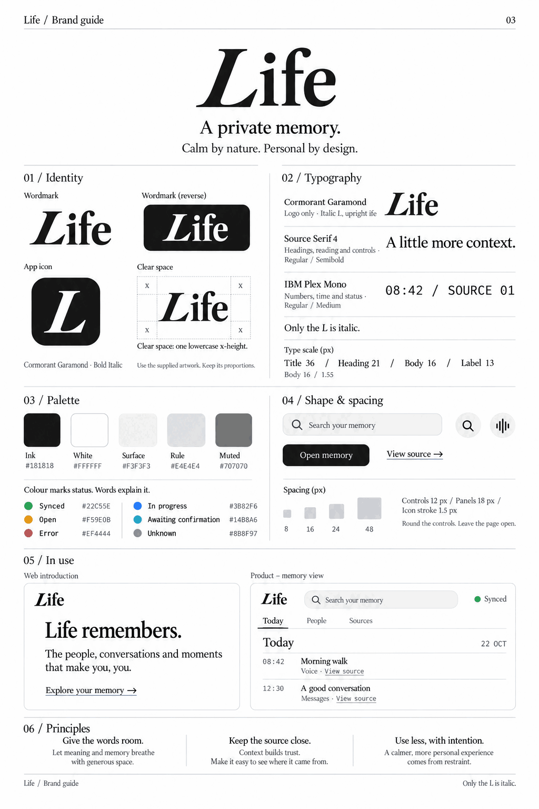

# Life's brand

The image is a visual reference; the exact values are the brand guide's and `assets/brand/tokens.css`'s.

A private memory. Calm by nature, personal by design. Everything Life shows follows this page: the nightly email,
`/check`, `/me`, the pairing page, the app (menu-bar panel, status window, settings, first run) and the icons.

## The values

One source: [`assets/brand/tokens.css`](../assets/brand/tokens.css). Pages link it or inline it; the two surfaces that
can't read CSS variables copy its values, and `src/brand.test.ts` fails when a copy drifts:

| Surface | How it takes the tokens |
| --- | --- |
| `/check` | `assets/check/index.html` links `tokens.css` (served at `/check/tokens.css`, `src/check.ts`) before `check.css` |
| `/me` password page, pairing page | `TOKENS` (`src/http.ts`) inlined in their styles (`src/portrait.ts`, `src/oauth.ts`) |
| Nightly email | `C`, `RADIUS`, `SERIF` and `MONO` in `src/memory/email.ts`, copied (mail takes no variables), light only |
| The app | `Brand` and `Tone.color` in `app/Sources/LifeApp/Brand.swift`, copied, light and dark |

No other file writes a colour: the test also fails on a hex colour anywhere else in `src`, `assets` or `app`.

- **Colour.** Monochrome: ink `#181818`, white `#FFFFFF`, surface `#F3F3F3`, rule `#E4E4E4`, muted `#707070`.
  Status colours are for dots, short stripes and small marks, always beside a word, never as text: synced
  `#22C55E`, open `#F59E0B`, error `#EF4444`, in progress `#3B82F6`, awaiting confirmation `#14B8A6`, unknown
  `#8B8F97`. Muted text goes on white, never on surface (4.46:1 there in light, under AA).
- **Dark.** The guide is light only. Dark is derived, its calm inverse: ink `#181818` as the ground, white text, surface
  `#242424`, rule `#333333`, muted `#A3A3A3`; status colours unchanged. The app and the pages follow the system; the
  email stays light.
- **Type.** Source Serif 4 (400, 600) for headings, reading, labels and controls; IBM Plex Mono (400, 500) for numbers,
  times, ids and status words. Page title 36/600/1.1, section heading 21/600/1.2, body 16/400/1.55, label 13/400/1.5,
  status 11.5/500/1.5. Nothing is italic but the L.
- **Shape.** Controls 12 px radius, panels 18 px, icon strokes 1.5 px, spacing 8, 16, 24, 48. Round the controls, leave
  the page open, fine rules only where content needs a boundary; no paper texture, gradients or decorative shadows.
  One primary action (an ink button); everything else stays light.
- **Kept on purpose.** The app's group and section labels are small mono capitals (a label is a status-like id there,
  not a heading), and `/check`'s card takes a border in its verdict's colour while it is swiped (a mark, not text).

## The mark

- **Wordmark.** "Life" in Cormorant Garamond Bold, only the L italic, outlined as one drawing:
  [`assets/brand/life.svg`](../assets/brand/life.svg) (the guide's L and its Cormorant "ife", set as the guide sets
  them). No surface sets it as text, so Cormorant ships nowhere. Leave one x-height clear around it.
- **Icon.** The white L on ink, a rounded square with 22% corners: [`assets/icon/icon.svg`](../assets/icon/icon.svg)
  (the README's, `/icon.svg`, rendered to `icon-512.png`), and `app.svg`, the same on macOS's icon grid.
  `scripts/app.ts` renders `app.svg` into `Life.icns`, and `life-l.svg` (the L alone, the menu bar's) and `life.svg`
  (the `Wordmark` view's) into template PDFs.

## Principles

Give the words room. Keep the source close: show where a memory came from. Make colour useful: status only.

Fonts are under the SIL Open Font License; their licences ship beside them in `app/Fonts`. Web pages load Source Serif
4 and IBM Plex Mono from Google Fonts.
