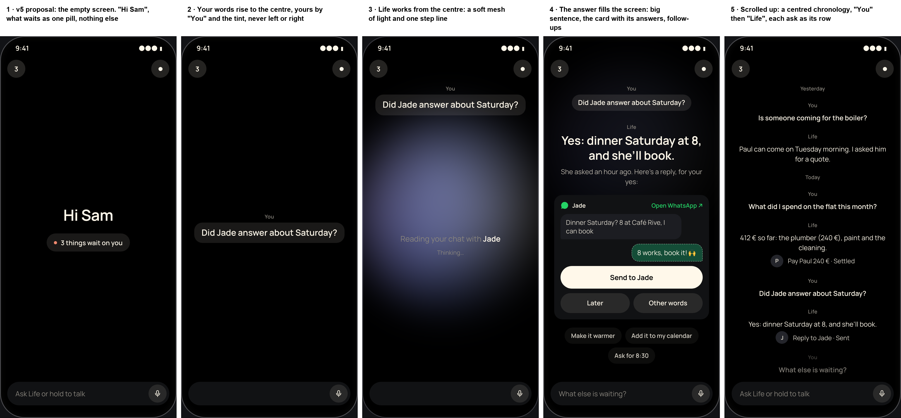

# v5 idea: turn by turn instead of a thread

Explanation: what the owner's idea of 27 Nov 2026 gains and loses against the approved app v4, whether SwiftUI can do
it, and a verdict. A proposal, not a decision. The mock is [`prototypes/v5-turns.html`](prototypes/v5-turns.html)
(states `#1` to `#5`), exported to [`screens-v5-turns-2026-11-27/`](screens-v5-turns-2026-11-27/); the approved
screens are untouched.

The idea: at most two turns on screen, the owner's and Life's. The owner's words rise to the centre, marked as the owner's
by a cue rather than a side. Life works from the centre under a soft mesh of light, then its answer fills the screen:
a large sentence, the card with its answers, the follow-ups. Scrolling up shows a centred chronology, "You" then
"Life". It is still a scroll view, but it reads as one screen per turn.

## What it gains

- Less to read at once. One question and one answer fill the screen; nothing from earlier competes with it. This is
  the cognitive-load rule applied to time, as the opening screen already applies it to arriving.
- The clean screen becomes the norm, not a state reached after 5 minutes away.
- The answer has room for a large sentence, pictures and components, so it feels like an app rather than a chat.
- What is on screen is exactly one turn, so "Life knows what's on the screen" needs no tracking of what is visible.
- The working state gets a place of its own in the centre, instead of one line under the owner's bubble.

## What it loses, or must solve first

- Arrivals. Today a follow-up card or a new ask lands at the bottom of the thread when the owner is free. In turn mode,
  a new arrival would either replace the answer the owner is reading or wait somewhere. It needs a rule, such as a quiet
  "1 more" pill, before it can ship.
- Live items in history. An ask answered or settled in an earlier turn must keep its live row in the chronology
  (mock, state 5). That is the same item model as today, but it is now the only place that ask can be found.
- Who said what at a glance. Left and right is how every chat shows it. Centred text needs a "You" and "Life" label,
  and labels are words where the brand wants marks.
- Reading. Centring suits one sentence. Paragraphs, lists and tables read worse centred, so only the headline should
  be centred and the body left-aligned.
- Long answers. A turn taller than the screen breaks the one-screen feel. Paging between turns then fights scrolling
  within one.
- Two presences. The edge is the approved sign that Life is there. A centre mesh is a second one, so while it shows
  the edge should dim.
- Accessibility. At the largest Dynamic Type sizes "fills the screen" becomes "overflows the screen". The mesh must
  stop under Reduce Motion.

Unchanged either way: the opening screen's rows, asks and cards with their answers, hold to talk in the field, `life:`
refs and Show earlier.

## Can SwiftUI do it

Yes, with tools already in iOS 26:

- `MeshGradient` (iOS 18) draws the mesh and animates its points; a `colorEffect` shader can replace it later if
  needed. Under Reduce Motion it holds still.
- `scrollPosition(id:)` with `scrollTargetBehavior(.viewAligned)` and `containerRelativeFrame` give one turn per
  screen; `matchedGeometryEffect` moves the owner's words to the top.
- The cost is mostly `Thread/ThreadView.swift` (380 lines today). The answer blocks (`AnswerView`, `BlockViews`), the
  items (`Items/`), the field and the edge are reused as they are. No server or data change.

## Verdict: adopt parts, in slices

Do not replace the thread with turns now. Arrivals and live asks rest on the thread, and v4 is being built on it. Take
the parts that remove load and keep everything that works:

1. First slice: each ask starts a fresh screen. On send, the owner's words move to the top edge, and the rest of the
   screen is kept for Life's answer. Life works in the centre of that space under the mesh, while the edge dims.
   Scrolling up is the same thread as today. This is a change to `ThreadView` plus one mesh view, with no change to
   items or arrivals.
2. Then a large headline sentence above the answer body, which stays left-aligned.
3. Only after both have run on the owner's real Life, decide on centring the owner's words and the "You" and "Life"
   chronology, with a rule for arrivals written first.
