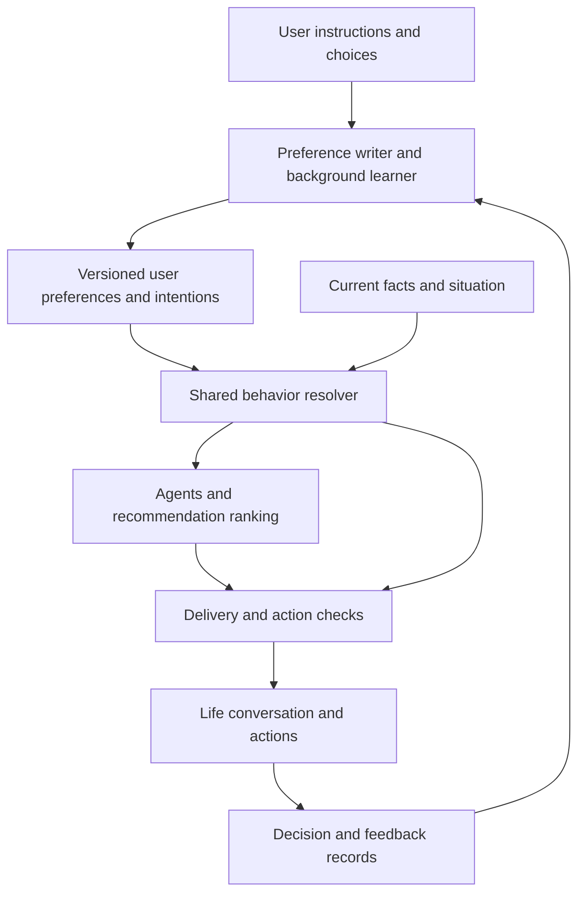

# One personalization layer for Life: outside research of 24 Nov 2026

Explanation: outside research the owner brought in on 24 Nov 2026, on how Life should learn and apply each person's
preferences without code changes, with a review against the code at `f35ab2e4`. It is input for the overhaul's plan
(issue #1373), to be weighed like the pi audit: not taken at face value. The review comes first; the research follows,
condensed.

## Review

**Checked against the code (true at `f35ab2e4`):**

- The main session's brief fixes its answers at "two short sentences at most, with no preamble and no emoji"
  (`desk/main-session.ts`, `MAIN_BRIEF`). A preference for longer answers would have nowhere to go.
- `changeDirectoryEntry` adds or replaces a goal but does not reorder or remove goals
  (`host/change-directory-entry.ts`, its header).
- The communication styles skip Life's own sent drafts (`sentDraftsOf`, `memory/communication-styles.ts`).
- Settings are read once per process (`core/settings.ts`; `AGENTS.md`), so a change made in one process is not seen
  by the others until they restart.
- His inbox's order is code's fixed rule: deadline, then kind, then age (`memory/check-urgency.ts`); a push's level is
  by card kind only (`host/card-push.ts`, the `notifications` setting).

**Not checked:** the papers and tools it cites (MemPABench, LangMem, Letta, ACE, GEPA, Graphiti).

**Worth taking into the first plan** (now in issue #1373):

1. One contract for what he wants of Life, separate from facts: his explicit instructions (scoped to a person,
   project, channel or everything; with an expiry; the earlier one it replaces; his words as their source) apart from
   what Life infers from his choices. This matches Life's own split: what he says is his record, an inference goes
   into a model-owned layer, used at once and corrected later (`AGENTS.md`, "Working with the owner"). Where his
   instructions live (`truth/` or a file of their own) is the plan's to propose and his to approve.
2. One reader of the rules that apply, used by the main session, the agents' packets and drafts, the inbox's order and
   the push. Rules about delivery (quiet until Monday, never this project after 19:00) are enforced by the code that
   notifies, not only written into a prompt.
3. Rules that change take effect in every process at the next turn or send, not at the next restart.
4. The decision records start keeping what is needed to learn later: what he was shown, in which order, which option
   was recommended, and which rules applied. Recording starts in the rework; learning comes later (the prediction
   plan). New fields on `decisions.jsonl` follow its append-only rules.
5. Importance, urgency, whether now is a good moment, and whether he can act now are kept apart, not folded into one
   rank. This is what the main session needs to be the gate on what reaches him (issue #1373).
6. A standing intention ("call Sam about once a month") is work with an end, tracked by the desk's waits and events,
   not a remembered sentence.

**For the prediction plan, not the first one:**

- The research disagrees with the owner's rule for the benchmark (an entry retired when it is old and fails): it says
  this would hide regressions, and that an entry should be retired only on evidence he changed. Left as it is until he
  decides.
- An accepted first option is weak evidence: the design shows the recommended answer first and most prominently. A
  suggested ask that was never seen was not rejected.

**Not for now:** hosting several people in one process; its own section says a preference file does not solve that.

## The research (condensed, its claims and links kept)

### Recommendation

**Life does not need a full rewrite. It needs one shared, versioned personalization layer that every part of the system uses.** Users should change it through ordinary conversation, and Life should improve it from their decisions—without changing application code or making PRs.

The distinction that matters is:

- **Life’s code defines its capabilities and guarantees.**
- **Each user’s data defines how those capabilities should serve them.**
- **A learning process improves that user’s data and decision rules over time.**

Inspected: `eric-edouard/life` at commit `f35ab2e4`, the recent rework issues, the repository’s prototype sources, and the current chat-first specification. The idea is already recorded in the [prediction-layer brief](https://github.com/eric-edouard/life/blob/f35ab2e43a05bc0dc2f9c5ca03dc54bd5e0bf940/docs/plans/2026-11-23-prediction-layer.md), which says it is not built and schedules Fable’s planning later.

**I would change that sequencing slightly: establish the preference contract and feedback records during the server rework. The sophisticated learning process can come afterward.** Otherwise, the redesigned agents, ranking and notifications will each develop another partial solution.

### 1. What Life already has—and what is missing

Personalization exists, but it is fragmented.

| Area | What exists today | What is missing |
|---|---|---|
| **Goals and priorities** | Goals in `truth/me.md`; projects, people and areas editable through a controlled writer. | A general way to express scoped behavioral preferences. The writer also explicitly omits goal reordering and deletion. [Source](https://github.com/eric-edouard/life/blob/f35ab2e43a05bc0dc2f9c5ca03dc54bd5e0bf940/apps/server/src/host/change-directory-entry.ts) |
| **How the user writes to someone** | Learned communication styles, already included in several drafting paths. | An immediate explicit override such as “from now on, be more direct with this person.” [Source](https://github.com/eric-edouard/life/blob/f35ab2e43a05bc0dc2f9c5ca03dc54bd5e0bf940/apps/server/src/memory/communication-styles.ts) |
| **Decisions and answers** | Stored cards, ordered options, drafts, selected answers and execution outcomes. | Complete decision-time context, actual exposure records, and a learning process that consumes them. [Source](https://github.com/eric-edouard/life/blob/f35ab2e43a05bc0dc2f9c5ca03dc54bd5e0bf940/apps/server/src/memory/decision-lines.ts) |
| **What gets prioritized** | A fixed hierarchy based substantially on card type, deadlines and importance. | Contextual prioritization according to the individual user. [Source](https://github.com/eric-edouard/life/blob/f35ab2e43a05bc0dc2f9c5ca03dc54bd5e0bf940/apps/server/src/memory/check-urgency.ts) |
| **What interrupts the user** | Notification levels configurable by card kind. | Rules by person, project, subject, situation and time. [Source](https://github.com/eric-edouard/life/blob/f35ab2e43a05bc0dc2f9c5ca03dc54bd5e0bf940/apps/server/src/host/card-push.ts) |
| **How Life answers** | The main-session brief mandates at most two short sentences, no preamble and no emoji. | User-controlled depth, tone and presentation, consistently applied. [Source](https://github.com/eric-edouard/life/blob/f35ab2e43a05bc0dc2f9c5ca03dc54bd5e0bf940/apps/server/src/desk/main-session.ts) |

That last example captures the problem: **Life could remember “I prefer detailed explanations” while its main system instruction still demands two sentences.**

There is also useful work to preserve. The communication-style learner excludes Life’s own sent drafts from its samples, preventing its generated writing from becoming self-reinforcing evidence about the user’s voice.

### 2. What should be customizable?

Internal capabilities; they do not require a settings screen for each one.

| Dimension | Examples of what a user might say |
|---|---|
| **Attention and interruptions** | “Don’t notify me about these.” “Bring work issues together in the morning.” “This person can interrupt me.” |
| **Importance and priorities** | “This project matters most until launch.” “This is optional.” “Family commitments come before work this weekend.” |
| **Proactivity** | “Prepare things quietly.” “Suggest opportunities.” “For this project, only help when I ask.” |
| **Delegation and approval** | “Draft replies automatically.” “Ask before changing my calendar.” “You can organize these files.” |
| **Communication with Life** | “Explain your recommendation.” “Give me one answer.” “Use French, but keep technical terms in English.” |
| **Communication with other people** | “Be warmer with her.” “Keep messages to this client formal.” “No emoji in work email.” |
| **Decision tradeoffs** | “Save me time even if it costs a little more.” “Prioritize walking distance.” “Avoid commitments on consecutive evenings.” |
| **Standing intentions** | “Help me stay in touch with this friend.” “Keep an eye on this application.” “Make sure I don’t forget renewals.” |
| **Follow-up behavior** | “Keep reminding me until this is done.” “If I defer it, leave it alone for a week.” |
| **Memory and boundaries** | “Remember these details.” “Don’t retain this subject.” “Don’t use work conversations when helping with personal matters.” |
| **Cost and responsiveness** | “Answer quickly for ordinary questions.” “Spend more effort on important decisions.” “Stay within this monthly budget.” |
| **Temporary circumstances** | “I’m travelling this week.” “Until Friday, only interrupt me for things that cannot wait.” |

**Scope is as important as the preference itself.** “Be concise” might apply globally, only to notifications, only to work messages, or only to the current answer.

Life should keep its product identity: one simple conversation, clear actions, little unnecessary work for the user. Personalization changes what it does for someone, when, and how—not require everyone to configure an assistant from scratch.

### 3. The architecture

#### A. Store different kinds of knowledge separately

A single `preferences.md` can be a readable summary. Underneath: structured, versioned records with natural-language content.

| Record | Meaning | Example |
|---|---|---|
| **Facts and current situation** | What Life believes is happening. | “This project launches next week.” |
| **Explicit preferences** | What the user has instructed Life to do. | “Don’t interrupt me about this project after 19:00.” |
| **Learned tendencies** | What Life tentatively infers from behavior. | “Usually prefers shorter drafts to this person.” |
| **Standing intentions** | Outcomes the user wants Life to maintain over time. | “Help me speak to this friend roughly monthly.” |
| **Permissions** | What Life is allowed to execute. | “May prepare a draft; sending requires approval.” |
| **Decision examples** | What was offered, what the user chose, and under which circumstances. | “Chose the closer venue despite the higher price.” |

Reuse Life’s persistence conventions: the explicit user-owned and inferred model-owned separation, append-only change records and an indexed current view. No graph database. Do not duplicate goals, projects or people in a second profile: preferences refer to their existing ids.

Each preference needs at minimum: its scope (person, project, channel, activity or global); its instruction or typed effect; whether explicit or inferred; its source evidence; when it applies and expires; which earlier rule it replaces; its revision and, for an inference, its evidence or confidence.

“Don’t ping me about the renovation this week” becomes a temporary delivery rule referring to that project, not “the user dislikes renovation”, and it does not erase the underlying work.

#### B. Resolve the applicable behavior through one shared function

```ts
resolveBehavior({ owner, activity, people, project, channel, time, situation })
```

It returns the instructions, attention rules, relevant priorities, explicit action limits and a record of which preferences were applied. An ordinary cached code path, not another LLM call before every action. The caller must name what the rules key on: a draft needs the recipient and channel, a notification its project, subject and deadline.

Precedence for ordinary preferences: the user’s current instruction; applicable explicit standing instructions; applicable learned tendencies; product defaults. Within a level, specificity, exceptions and validity in time resolve conflicts. Permissions have their own explicit grant and revocation: accepting suggestions must never silently widen what Life may do.

#### C. Apply rules in both generation and execution

- **Generative guidance:** tone, explanation depth, decision tradeoffs, relevant examples.
- **Rules the application enforces:** notification suppression, quiet periods, spending limits, allowed actions and expiry.

“Don’t push notifications about this project until Monday” must be enforced by the notification code, not only remembered in an agent’s context.



#### D. Keep the complete task state independent of what gets surfaced

Code keeps the complete list while the main session decides what deserves attention (issue #1373). Keep apart: **importance** (how much the outcome matters), **urgency** (how much is lost by waiting), **interruptibility** (whether now is a good moment), **actionability** (whether the user can do anything useful now). The same delivery decision governs the thread, badge, notifications and reminders, or a quiet conversation coexists with a noisy notification worker.

#### E. Treat standing intentions as durable work

“Help me call Sam monthly” needs a target, evidence of the last qualifying contact, an approximate cadence, conditions for surfacing it, and a definition of completion. The preference layer says how to pursue it; the existing waits, events and task machinery track whether it is fulfilled.

### 4. Learning from decisions

Keep “was the first recommendation accepted?” as a metric, not as the sole explanation of what went wrong.

| User behavior | What Life should initially conclude |
|---|---|
| Accepts the first suggestion unchanged | Positive evidence for that recommendation in that context. |
| Chooses another option | A mismatch requiring diagnosis. |
| Says “Later” | Usually a timing signal. |
| Edits the draft | Possibly a factual, tone, length or commitment correction. |
| Says “Always do it this way” | An explicit standing instruction. |
| Does nothing | Often unknown: the user may not have seen it. |
| Approves, but the send fails | An execution failure; the recommendation may have been right. |

The loop:

1. **Record the decision as it happened:** the evidence available then, the options in their displayed order, the recommended option, the preference revisions applied, model and prompt versions, what the user actually saw, the response and the execution result. A suggestion never visible was not rejected; a visually prominent recommendation biases acceptance.
2. **Diagnose the mismatch:** missing or wrong facts, wrong preference or priority, wrong timing, an unneeded interruption, poor wording, changed circumstances, a one-off exception, an execution or interface problem.
3. **Make the smallest justified update.** An explicit instruction takes effect at once; an inferred tendency needs proportionate evidence. “Make this shorter” applies to the current item; “always keep these shorter” supports a lasting rule.
4. **Replay the original case safely:** with the facts available then, external actions off, never seeing the eventual answer. If the choice rested on facts Life didn’t have, the better behavior may be a clarifying question.
5. **Check that it generalizes:** the original case, similar cases, and contrasting cases where the rule must not apply. Keep update, selection and test examples apart (as DSPy’s GEPA does).
6. **Activate a versioned update and watch it:** keep the previous version, apply atomically, allow rollback; a delayed job checks for a newer user instruction first. Bounded budget: rewriting until every past case passes overfits and costs.

**One rule in the current prediction brief should change.** Retiring an example when it is old and can no longer be predicted would hide regressions: a worse update could look successful by dropping the cases it broke. Retire or supersede an expectation on evidence of changed preferences, expired circumstances or a mistaken label; keep the record and its conditions.

**Measure usefulness alongside agreement:** recommendations accepted unchanged among those shown; unwanted interruptions; important obligations missed; edits and repeated corrections; task completion; later reversals.

### 5. How this stays invisible in the new app

“Don’t interrupt me about this project this week.” Life applies the scoped rule and acknowledges it: “I’ll keep updates on this project quiet until Monday,” with Undo, no card. “Use this tone with Nora from now on” updates the guidance every drafting agent uses. “What have you learned about how I like things?” gets a readable answer separating what was asked from what was inferred, amended by conversation. No preference dashboard, questionnaire or queue of memory edits.

### 6. What current research supports

- **MemPABench** (Oct 2026, arxiv 2610.30485): personal-agent memory for when to ask, act, explain and initiate contact. Across four simulated users and four backbones, memory systems struggled to select and apply interaction preferences; file-based memory improved selection but sometimes applied preferences too broadly; even the correct preference supplied did not guarantee the behavior. Lesson: evaluate separately whether Life remembered the preference, applied it to the right situation, and followed it.
- **LangMem:** separate profiles, contextual memories and decision examples; immediate updates plus background processing.
- **Letta:** persistent shared memory and background consolidation (git-backed memory, “dreaming”).
- **ACE:** improve context by incremental reflection and curation, no weight updates.
- **GEPA:** feedback-driven optimization with separate update, selection and test sets.
- **Graphiti:** temporal validity and provenance, without needing a graph database.

Adopt these patterns within Life; switching the agent framework would not settle preference precedence, delivery, permissions or feedback interpretation.

### 7. How it fits the rework

**First, the shared foundation:** versioned explicit preferences, inferred tendencies and standing intentions; conversational writers following the validated directory-writer pattern; one resolver with scope, precedence, expiry and provenance; a readable summary with edit, remove and undo; defaults kept apart from a user’s choices. First demonstration: “give me more detailed answers”, respected across sessions.

**Second, connect every path and record decisions:** the main session, agent packets and drafting (`readPacket` in `desk/agent-actions.ts`, `desk/main-session.ts`), relevant connector reads, recommendations, inbox ranking (`memory/check-urgency.ts`) and push (`host/card-push.ts`), deferrals and standing intentions, action checks. Handle revisions across processes: settings are cached per process (`core/settings.ts`), so the layer needs scoped invalidation, refresh on the next turn, and a current-rule check before a queued notification or action. Start recording context, exposures and feedback now.

**Third, the bounded background learner:** mismatch classification, small candidate updates, replay, contrasting-case checks, promotion or rollback. Add decision cases; the memory eval (`scripts/eval.ts`) is not a preference benchmark. Test conflicting profiles: concise vs reasoned; proactive vs minimal; a person’s rule not leaking to others; “Later” not becoming permanent; a new instruction overriding an older tendency; a preference surviving restarts and applying across agents.

**Two boundaries:** no-code customization covers behavior within built capabilities (a new integration still needs code); and personalization is not multi-user hosting, which would need owner context through storage, credentials, caches and jobs (`core/paths.ts`).
